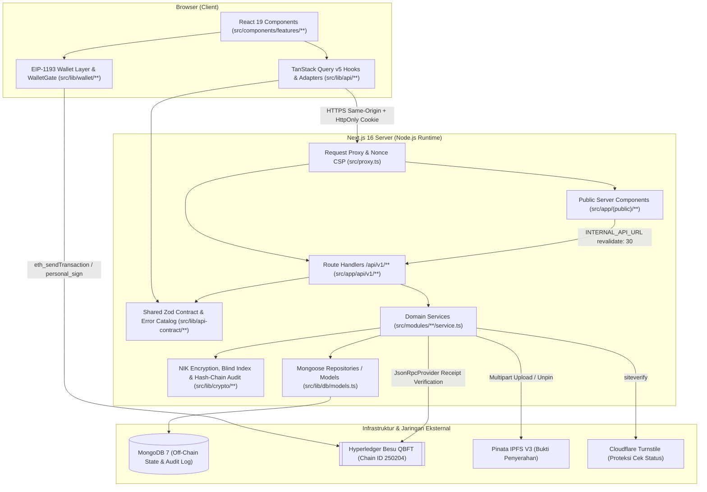

# Arsitektur Sistem — BansosLedger

Dokumen ini menjelaskan arsitektur berlapis, alur data penyaluran bantuan sosial (off-chain dan on-chain), serta batas kepercayaan (*trust boundaries*) pada **BansosLedger** sesuai [`docs/PRD.md`](./PRD.md) v2.7.

---

## 1. Gambaran Umum Lapisan (*Layered Architecture*)

### Aturan Ketat Antar-Lapisan
1. **Route Handlers (`src/app/api/v1/**/route.ts`)**: Hanya melakukan parsing request, memverifikasi izin melalui `requirePermission`, memanggil fungsi di `src/modules/<domain>/service.ts`, dan mengembalikan DTO tervalidasi atau error RFC 9457 (`application/problem+json`).
2. **Domain Services (`src/modules/<domain>/service.ts`)**: Seluruh kode backend diawali dengan `import 'server-only'`. Berisi aturan bisnis, validasi pre-flight, enkripsi/dekripsi NIK, verifikasi receipt on-chain (`chainVerifier`), serta pencatatan log audit berantai (*hash-chained audit log*).
3. **Shared Contract (`src/lib/api-contract/**`)**: Skema Zod dan katalog kode error yang dipakai bersama oleh backend dan frontend (tanpa `server-only`). Tidak pernah membocorkan field internal Mongoose (`_id`, `__v`, `schemaVersion`, hash token, atau kunci penyimpanan).
4. **Frontend Feature Components (`src/components/features/**`)**: Hanya merender UI dan memanggil hook dari `src/lib/api/hooks/**` serta `src/lib/wallet/**`. Komponen dilarang memanggil `fetch()` secara langsung dan dilarang mengimpor `mongoose`, `server-only`, atau `src/modules/**`.

---

## 2. Alur Data Utama (*Data Flows*)

### 2.1 Privasi Identitas Penerima (UU PDP)
1. **Penyimpanan Off-Chain (`DRAFT`)**:
   - NIK 16 digit divalidasi formatnya, dienkripsi dengan **AES-256-GCM** menggunakan `NIK_ENC_KEY`, dan diindeks secara buta (*blind index*) dengan **HMAC-SHA256** menggunakan `NIK_INDEX_KEY`.
   - Secara default API hanya mengembalikan `nikMasked` (4 digit awal + `••••••••` + 4 digit akhir).
2. **Finalisasi (`FINAL`) & Komitmen Kriptografis**:
   - Saat operator mengunci penerima ke status `FINAL` (konfirmasi ganda), server menghitung komitmen identitas satu arah:
     $$\text{commitment} = \text{keccak256}(\text{NIK} \parallel \text{COMMITMENT\_PEPPER})$$
   - Hanya `commitment` (`bytes32`) yang dikirim ke smart contract `BansosLedger.sol`. NIK, nama, alamat, dan nomor telepon tidak pernah ditulis ke blockchain.
3. **Pembukaan NIK Sementara (`POST /api/v1/recipients/:id/reveal-nik`)**:
   - Dibatasi maksimal 30 kali per jam per pengguna, wajib dicatat di log audit (tanpa menyertakan NIK asli di log), tidak disimpan di cache query, dan otomatis disamarkan kembali di UI setelah 30 detik.

### 2.2 Alur Penyaluran & Verifikasi Receipt On-Chain
1. **Pre-flight & Simpan `DRAFT`**:
   - Server menyalin `amountPerRecipient` langsung dari program (klien tidak dapat mengirim nominal).
   - `POST /api/v1/disbursements` dilindungi oleh header `Idempotency-Key` (UUID per wizard) dan indeks unik parsial MongoDB pada `(programId, recipientId, periodId)` untuk mencegah penyaluran ganda.
2. **Unggah Bukti Penyerahan (IPFS / Pinata V3)**:
   - Server memeriksa *magic bytes* berkas (`FF D8 FF` untuk JPEG, `%PDF` untuk PDF), menghapus metadata EXIF lokasi/kamera pada JPEG dengan `sharp`, dan mengunggah ke jaringan publik Pinata V3 untuk mendapatkan `cid`.
3. **Tanda Tangan Dompet (`<WalletGate>`) & Konfirmasi Server**:
   - Server membentuk *transaction intent* (`to`, `data`, `chainId`).
   - Operator menandatangani transaksi di browser melalui dompet EIP-1193 (`window.ethereum`) — **server tidak pernah memegang private key operator**.
   - Setelah `txHash` dikirim ke `PATCH /api/v1/disbursements/:id/tx-submitted`, status menjadi `PENDING`.
   - Status **`SUCCESS` hanya ditulis oleh server** (`POST /api/v1/disbursements/:id/confirm` atau rekonsiliasi cron) setelah server sendiri memverifikasi receipt dari RPC blockchain:
     - `receipt.status === 1`
     - `receipt.to` cocok dengan `NEXT_PUBLIC_CONTRACT_ADDRESS`
     - Event `DisbursementRecorded` terdekode memiliki `refId`, `programId`, `periodId`, `recipientCommitment`, `amount`, `evidenceCid`, dan `recordedBy` (`authorizedWallet`) yang persis sama dengan catatan database.

---

## 3. Batas Kepercayaan (*Trust Boundaries*)

| Batas (*Boundary*) | Ancaman yang Diasumsikan | Kontrol Keamanan yang Diterapkan |
| --- | --- | --- |
| **1. Browser Pengunjung Publik → Proxy & Route Handlers** | Scraping NIK, enumerasi penerima, XSS, spam Cek Status | NIK hanya diterima di JSON body `POST /api/v1/public/status-check` (query string 16 digit ditolak dengan `400 NIK_IN_QUERY`), wajib Cloudflare Turnstile + *rate limit* per IP & per blind-index + *timing padding* 600–700 ms, serta CSP bernonce per request di [`src/proxy.ts`](../src/proxy.ts). |
| **2. Browser Petugas Terautentikasi → Server API** | CSRF, eskalasi hak akses (RBAC), manipulasi nominal/status, replay tanda tangan wallet | Sesi disimpan di server dengan cookie `HttpOnly`, `SameSite=Lax`, `__Host-` (di HTTPS). Setiap mutasi memeriksa header `Origin` (`isSameOriginRequest`) dan izin eksplisit (`requirePermission`). Pengikatan wallet sesi menggunakan tantangan nonce sekali pakai (`personal_sign`). |
| **3. Klien Dompet (EIP-1193) → Server Verifier** | Klien mengklaim transaksi berhasil atau mengirim `txHash` palsu/milik transaksi lain | Server tidak pernah mempercayai klaim klien; `chainVerifier` membaca langsung receipt dari `RPC_URL_SERVER` dan mencocokkan seluruh argumen event `DisbursementRecorded` sebelum mengubah status ke `SUCCESS`. |
| **4. Server Aplikasi → MongoDB & Log Audit** | Modifikasi diam-diam atas riwayat tindakan atau rekaman penyaluran | Koleksi `AuditLogs` bersifat *append-only* dan terhubung dalam rantai hash SHA-256 (`prevHash` → `hash` dengan nomor urut `seq`), yang dapat diverifikasi kapan saja melalui `GET /api/v1/audit-logs/verify`. Penerima berstatus `FINAL` tidak dapat diubah atau dihapus. |
| **5. Server Aplikasi → Smart Contract (`BansosLedger.sol`)** | Kehilangan kepemilikan kontrak atau eksekusi oleh wallet tidak berwenang | Kontrak menggunakan `Ownable2Step` dengan `renounceOwnership()` dinonaktifkan secara permanen (`revert RenounceDisabled()`), dilengkapi mekanisme `Pausable`, dan membatasi fungsi tulis hanya untuk `authorizedWallet` / `owner`. |

