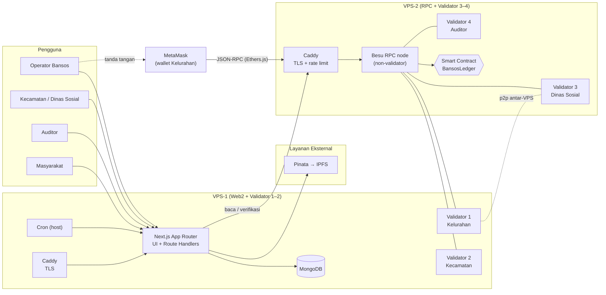
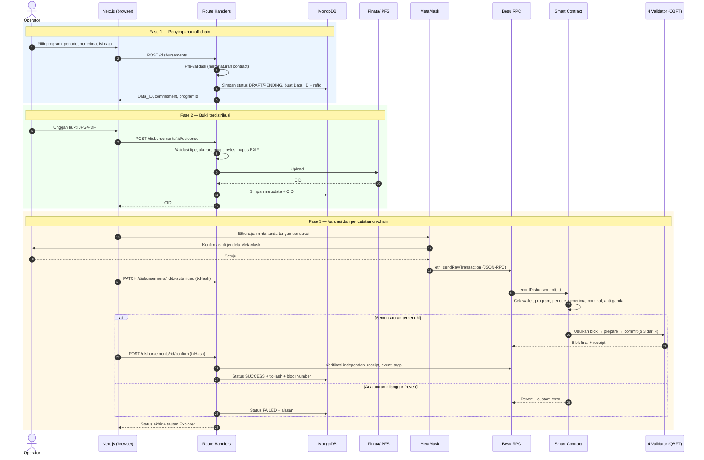
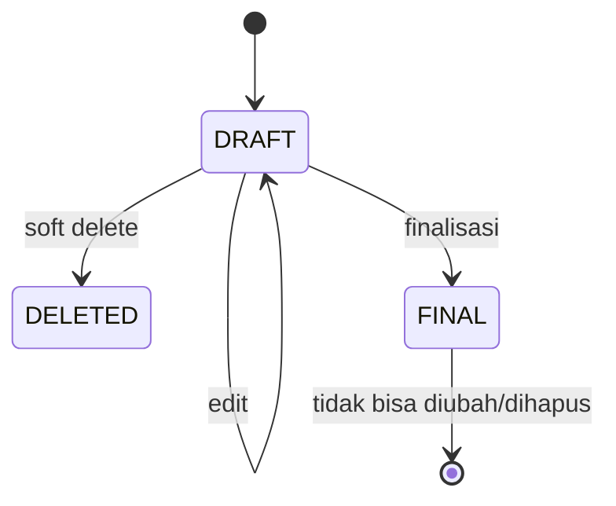
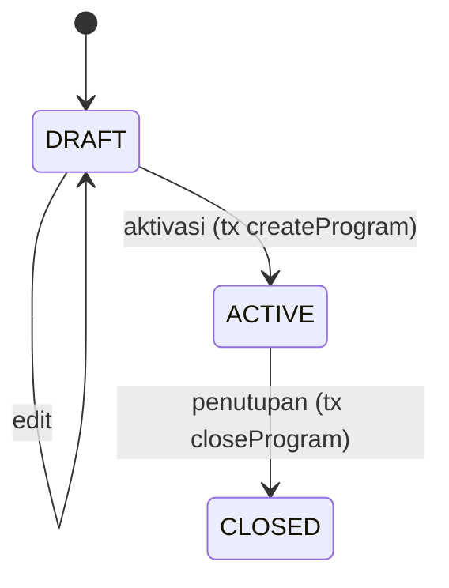
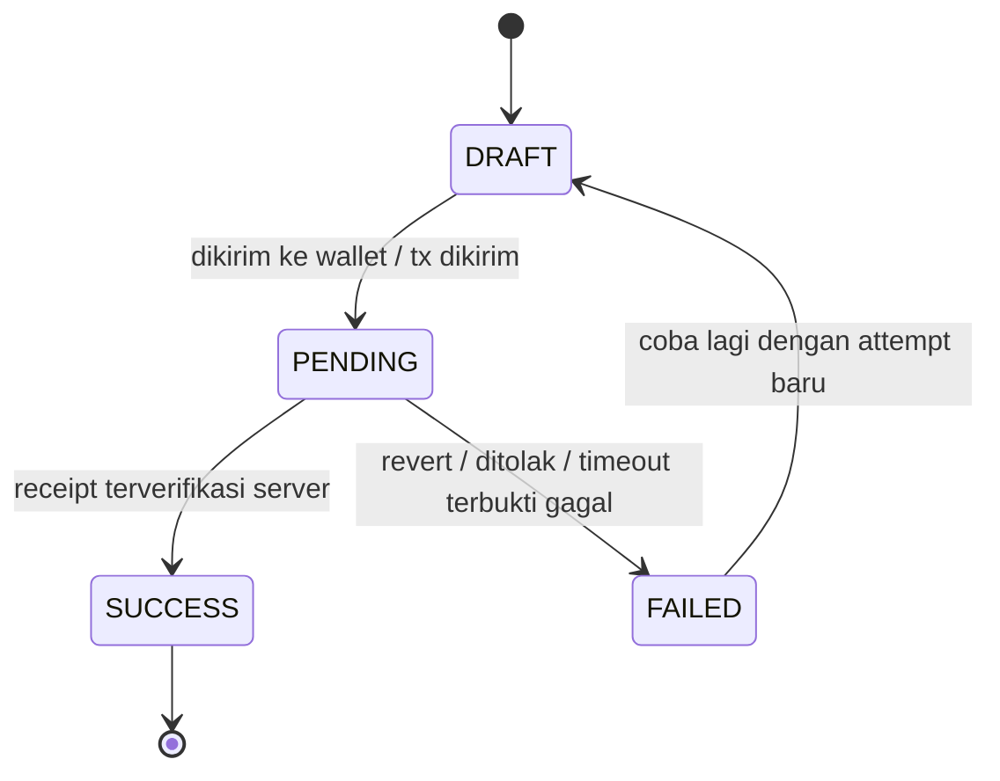

# PRD — BansosLedger

**Sistem Pelaporan dan Transparansi Dana Bantuan Sosial Berbasis Blockchain dan Smart Contract**

| Atribut | Nilai |
| --- | --- |
| Versi dokumen | **2.9 — Source of Truth** |
| Tanggal | 6 November 2026 |
| Menggantikan | PRD v2.8 (3 Nov 2026), v2.7 (31 Okt 2026), v2.6 (29 Okt 2026), v2.5 (28 Okt 2026), v2.4, v2.3 dan v2.2 (27 Okt 2026), v2.1 (26 Okt 2026), dan v1.0 (26 Sep 2026, "Rancangan Sebelum Observasi") |
| Sumber | PRD v1.0, Tabel User Role & Permission Matrix v1.0, Proposal Skripsi (Rahmat Hidayat, NIM 220209552013, UNM), serta 10 keputusan pemilik produk tanggal 27 Okt 2026 dan tiga koreksi susulan (Bagian 22.1, D-15 s.d. D-54) |
| Lokasi studi kasus | Kelurahan Takkalasi, Kec. Balusu, Kab. Barru, Sulawesi Selatan |
| Status | Keputusan pemilik produk 27 Okt–6 Nov 2026 sudah dikunci, termasuk **2FA TOTP end-to-end, pembersihan rute lama, seed dan skrip skenario, artefak infrastruktur, CI/CD lengkap, dokumentasi operasional, banner pemeliharaan + SEO**, dan penutupan Q-25. Proyek dijalankan **lokal** dulu; pilot VPS menyusul. Pertanyaan yang masih terbuka ada di **Bagian 21** (Blocker: Q-02) |

---

## 0. Cara Membaca Dokumen Ini

### 0.1 Penanda sumber

Setiap keputusan penting diberi penanda supaya jelas asalnya.

| Penanda | Arti |
| --- | --- |
| **[SUMBER]** | Berasal langsung dari PRD v1.0, matriks role, atau skripsi Anda. Dianggap sudah final kecuali Anda ubah. |
| **[REKOM]** | Rekomendasi saya (best practice). Boleh diubah, tetapi perlu alasan tertulis di Decision Log. |
| **[OPEN]** | Belum bisa diputuskan dari dokumen. Sudah diberi **default** supaya pengembangan tidak terblokir. Daftar lengkap ada di Bagian 21. |
| **[FINAL]** | Sudah diputuskan pemilik produk. Berlaku sebagai keputusan, bukan lagi usulan atau default. Keputusan 27 Okt 2026 dicatat sebagai D-15 s.d. D-22 di Bagian 22.1. |

### 0.2 Prioritas (MoSCoW)

**M** = Must (wajib ada di rilis prototype), **S** = Should (sangat disarankan), **C** = Could (jika waktu cukup), **W** = Won't (tidak di rilis ini).

### 0.3 Aturan dokumen ini sebagai Source of Truth

1. Jika ada konflik antara dokumen ini dan PRD v1.0 atau skripsi, **dokumen ini yang berlaku**. Perbedaan dicatat di Bagian 22 (Decision Log) dan harus ikut diperbarui di skripsi bila relevan.
2. Setiap perubahan requirement dilakukan lewat perubahan dokumen ini (bukan hanya di kode) dan dicatat di Changelog (Bagian 23).
3. Setiap requirement punya ID unik (mis. `FR-DSB-04`) yang dipakai juga di test case, issue tracker, dan commit message.

---

## 1. Ringkasan Eksekutif

**BansosLedger** adalah aplikasi web hybrid Web2–Web3 untuk **mencatat, memvalidasi, dan membuka ke publik riwayat penyaluran bantuan sosial** di tingkat kelurahan, setelah daftar penerima ditetapkan oleh pihak berwenang.

Inti sistem:

- **Web2 (off-chain)**: Next.js + MongoDB mengelola data operasional (penerima, program, penyaluran, akun, log). Data pribadi seperti NIK tetap off-chain dengan akses terbatas dan enkripsi.
- **Web3 (on-chain)**: smart contract Solidity di jaringan privat **Hyperledger Besu (QBFT, 4 validator)** memvalidasi aturan penyaluran dan mencatat hasilnya secara permanen.
- **Bukti penyaluran**: berkas JPG/PDF diunggah ke IPFS lewat Pinata. Hanya **CID** yang dicatat on-chain.
- **Transparansi**: masyarakat dan auditor dapat menelusuri transaksi lewat halaman publik dan Blockchain Explorer, tanpa melihat data pribadi.

**Yang BUKAN dilakukan sistem ini:** sistem **tidak memindahkan uang** dan tidak menerbitkan token. Sistem mencatat dan memvalidasi bahwa suatu penyaluran terjadi sesuai aturan. Pembayaran sebenarnya tetap berjalan lewat mekanisme yang ada (tunai, bank, pos, dsb.).

---

## 2. Latar Belakang dan Masalah

**[SUMBER]** Permasalahan yang diangkat dari skripsi:

| # | Masalah | Dampak |
| --- | --- | --- |
| P1 | Pencatatan terpusat dan manual rawan **manipulasi data** | Data bisa diubah tanpa jejak |
| P2 | **Penyaluran ganda** pada penerima yang sama di program/periode yang sama (temuan BPK 2021 tentang bantuan ganda) | Tumpang tindih, anggaran boros, ketimpangan |
| P3 | Nilai bantuan yang dicatat **tidak sesuai ketentuan** | Potensi pemotongan/penyelewengan |
| P4 | **Keterlambatan dan lemahnya pelaporan** serta bukti penyaluran tidak terhubung dengan catatan transaksi | Sulit diperiksa dan diaudit |
| P5 | **Keterbukaan informasi terbatas**, partisipasi pengawasan masyarakat rendah | Kepercayaan publik turun |

**Celah penelitian [SUMBER]:** penelitian sebelumnya (Arya & Suwarno, 2024) sudah mencatat penyaluran di blockchain, tetapi belum mencegah penyaluran ganda per program/periode dan belum menghubungkan bukti realisasi dengan catatan transaksi. BansosLedger mengisi dua celah itu.

**Fokus proses [SUMBER]:** sistem berfokus pada proses **setelah penetapan penerima**: pencatatan penyaluran, status realisasi, dokumentasi bukti, pencegahan penyaluran ganda, dan riwayat transaksi yang dapat ditelusuri. Penetapan dan verifikasi kelayakan penerima berada di luar cakupan.

---

## 3. Tujuan, Non-Tujuan, dan Indikator Keberhasilan

### 3.1 Tujuan produk

| ID | Tujuan | Terhubung ke rumusan masalah skripsi |
| --- | --- | --- |
| G1 | Menolak otomatis transaksi penyaluran yang melanggar aturan (ganda, nominal salah, wallet tak berwenang, penerima tak sah) | RM-1 (meminimalkan penyelewengan) |
| G2 | Menjamin setiap penyaluran yang berhasil punya jejak permanen: TxID, blok, timestamp, wallet, CID bukti | RM-1 |
| G3 | Memberi publik dan auditor cara memverifikasi penyaluran tanpa membuka data pribadi | RM-1 |
| G4 | Memberi operator kelurahan alat kerja yang praktis (data, program, penyaluran, laporan) | RM-1, RM-2 |
| G5 | Memenuhi kualitas perangkat lunak menurut ISO/IEC 25010:2023 pada 9 karakteristik | RM-2 |

### 3.2 Non-tujuan (di luar cakupan rilis ini)

| ID | Non-tujuan | Alasan |
| --- | --- | --- |
| NG1 | Penetapan, seleksi, atau verifikasi kelayakan penerima | **[SUMBER]** di luar cakupan skripsi |
| NG2 | Transfer dana, pembayaran, dompet digital, token/kripto | Sistem hanya mencatat dan memvalidasi |
| NG3 | Integrasi langsung dengan DTKS/SIKS-NG, bank penyalur, atau SP2D | Tahap lanjutan |
| NG4 | Aplikasi mobile native | Web responsif sudah cukup |
| NG5 | Deploy ke blockchain publik (Ethereum mainnet, Polygon, dll.) | Jaringan privat berizin sesuai skripsi |
| NG6 | Multi-kelurahan / multi-tenant | Tidak dibangun sekarang, tetapi desain data menyisakan ruang (lihat NFR Flexibility) |
| NG7 | Menjalankan 4 validator pada infrastruktur milik masing-masing institusi | **[SUMBER]** prototype: 4 container pada **dua VPS (2+2)** yang dikelola satu pihak (batasan diakui, lihat Risiko R-01) |
| NG8 | Mengumpulkan data sosial-ekonomi penerima (KK, pekerjaan, penghasilan, tanggungan) | Minimisasi data (UU PDP); penetapan penerima ada di luar cakupan (NG1) **[FINAL K1, D-36]** |

### 3.3 Indikator keberhasilan (acceptance di level produk)

**[SUMBER]** kriteria penerimaan dari PRD v1.0, dibuat terukur:

| ID | Indikator | Target | Cara ukur |
| --- | --- | --- | --- |
| KPI-1 | Skenario potensi penyelewengan yang ditangani benar | **100%** (Guttman, semua skenario SP-01…SP-09) | Bagian 17.1 |
| KPI-2 | Setiap karakteristik ISO/IEC 25010:2023 (Guttman) | **≥ 81%** ("Sangat Baik") | Bagian 14 dan 17.2 |
| KPI-3 | Interaction Capability (Likert 4 tingkat, 15 responden: 5 pengelola kelurahan + 10 masyarakat) | **≥ 80%** ("Layak") | Bagian 14 |
| KPI-4 | Google Lighthouse Performance (halaman publik) | **≥ 90** desktop; **≥ 90** mobile **[FINAL]** | Lighthouse CI |
| KPI-5 | Smart contract terdeploy pada Besu dan 4 validator QBFT aktif | 4/4 validator menandatangani blok | Bagian 18 |
| KPI-6 | Transaksi valid terkonfirmasi dan dapat ditelusuri lewat Explorer | 100% transaksi SUCCESS punya TxID yang cocok di chain | Rekonsiliasi (FR-CHN-04) |
| KPI-7 | Integrasi Web2–Web3 end-to-end berjalan | Skenario alur utama lulus E2E | Bagian 17 |
| KPI-8 | Temuan keamanan severity High/Critical pada Web2 dan Web3 | **0** terbuka saat rilis | Acunetix/ZAP, Slither |

---

## 4. Lingkup, Asumsi, dan Batasan

### 4.1 Dalam lingkup (MVP prototype)

1. Autentikasi akun internal (akun dibuat lewat skrip seed/CLI, tanpa UI admin), otorisasi berbasis role, dan **pengikatan wallet** Kelurahan.
2. Pengelolaan **penerima** (draft → final, soft delete untuk draft).
3. Pengelolaan **program bantuan** dan **periode**, termasuk pendaftaran penerima ke program.
4. Pencatatan **penyaluran** + unggah **bukti** (IPFS) + pengiriman transaksi smart contract.
5. **Validasi smart contract**: wallet berwenang, penerima terdaftar, program/periode, nominal, anti-ganda.
6. Dashboard internal, laporan, dan log aktivitas.
7. **Halaman publik**: transparansi, daftar program, cek status bantuan, dan **Blockchain Explorer**.
8. Jaringan **Hyperledger Besu QBFT** 4 validator + 1 node RPC non-validator.
9. Pengujian: skenario penyelewengan + 9 karakteristik ISO/IEC 25010:2023.

### 4.2 Backlog (setelah prototype)

Maker-checker multi-level (jika dikonfirmasi), UI pengelolaan akun oleh admin teknis, 2FA wajib untuk semua role internal, anchoring log audit ke blockchain, integrasi DTKS, notifikasi (WhatsApp/email), kanal pengaduan masyarakat, validator pada infrastruktur masing-masing institusi, dan Blockscout sebagai explorer pembanding.

### 4.3 Asumsi

| ID | Asumsi | Jika salah |
| --- | --- | --- |
| A-01 | Daftar penerima sudah ditetapkan pihak berwenang dan menjadi **input awal** sistem | Perlu modul penetapan (di luar cakupan) |
| A-02 | Nominal bantuan per penerima per program bersifat **tetap** dalam satu program | Smart contract perlu aturan nominal variabel |
| A-03 | Satu **wallet aplikasi Kelurahan** dipakai bersama oleh pengguna operator | Akuntabilitas individu hanya lewat log off-chain (lihat R-05) |
| A-04 | Bantuan dicatat dalam **rupiah utuh** (tanpa desimal); bantuan barang dicatat dengan nilai taksiran | Perlu model satuan barang |
| A-05 | Jumlah penerima per program pada pilot ≤ 500 | Perlu uji kapasitas dan batching lebih besar |
| A-06 | Zona waktu pengguna **WITA (UTC+8)**; penyimpanan selalu UTC | — |
| A-07 | Bahasa antarmuka **Bahasa Indonesia** | Perlu i18n |

### 4.4 Batasan

| ID | Batasan | Sumber |
| --- | --- | --- |
| C-01 | Web2 (Next.js + API + MongoDB) di **VPS-1**; Web3 (Besu 4 validator + 1 RPC) dibagi di **VPS-1 dan VPS-2**, masing-masing **4 GB RAM** **[FINAL]** | Semula **[SUMBER]** (Web2 di cloud hosting); diubah pemilik produk, skripsi perlu disesuaikan (Lampiran C) |
| C-02 | Hardhat hanya untuk **development dan unit test** smart contract, bukan runtime | **[SUMBER]** |
| C-03 | Kunci validator Besu **dipisahkan** dari private key wallet aplikasi | **[SUMBER]** |
| C-04 | Hard delete data final **tidak diberikan ke siapa pun** | **[SUMBER]** |
| C-05 | NIK asli **tidak pernah** ditulis ke blockchain | **[SUMBER]** |
| C-06 | Alat uji yang dipakai skripsi: Lighthouse, Hardhat Gas Reporter, Slither, Acunetix | **[SUMBER]** |

---

## 5. Pemangku Kepentingan dan Aktor

### 5.1 Aktor manusia

| Aktor | Peran di aplikasi | Hak data | Peran blockchain | Sumber |
| --- | --- | --- | --- | --- |
| **Operator Bansos** — Kelurahan Takkalasi | Pengelolaan operasional data bansos | Create, Read, Update, Soft Delete (hanya draft) | Validator 1 | **[SUMBER]** |
| **Kecamatan Balusu** | Koordinasi dan monitoring administratif wilayah | Read Only | Validator 2 | **[SUMBER]** |
| **Dinas Sosial Kab. Barru** | Monitoring dan verifikasi data/program sesuai kewenangan | Read Only | Validator 3 | **[SUMBER]** |
| **Auditor / Pihak Pengawas** | **Tidak** masuk dashboard operasional | Audit lewat Explorer dan informasi publik yang diizinkan | Validator 4 | **[SUMBER]** |
| **Masyarakat / Penerima** | Pengguna publik | Public read-only | Bukan validator | **[SUMBER]** |

> **Pembuatan akun [FINAL Q-03]:** tidak ada aktor System Admin. Akun Operator, Kecamatan, dan Dinas Sosial dibuat dan dinonaktifkan lewat skrip seed/CLI yang dijalankan pengembang di server (FR-USR-01 s.d. 04). Akibatnya aplikasi tidak memiliki UI maupun endpoint pengelolaan akun.

### 5.2 Aktor sistem

| Aktor sistem | Fungsi |
| --- | --- |
| Smart contract `BansosLedger` | Otoritas akhir validasi aturan penyaluran |
| 4 validator Besu (QBFT) | Mengusulkan dan mengesahkan blok; **tidak** memberi persetujuan manual per transaksi |
| Node RPC non-validator Besu | Gerbang JSON-RPC untuk aplikasi dan explorer |
| Pinata / IPFS | Penyimpanan bukti, menghasilkan CID |
| MongoDB | Penyimpanan data operasional off-chain |
| Scheduler (cron) | Rekonsiliasi status PENDING, pembersihan sesi |

### 5.3 Persona ringkas

| Persona | Tujuan | Kekhawatiran | Implikasi desain |
| --- | --- | --- | --- |
| **Operator kelurahan** (staf, mungkin kurang mahir teknologi) | Input cepat, tidak salah, laporan siap | Takut salah klik saat tanda tangan wallet | Alur bertahap (stepper), validasi dini, pesan error berbahasa Indonesia sederhana |
| **Staf Kecamatan/Dinas** | Memantau realisasi tanpa mengubah data | Data tidak sinkron, tidak tahu siapa mengubah apa | Dashboard read-only jelas, log aktivitas |
| **Auditor** | Memverifikasi independen | Data bisa diubah diam-diam | Explorer lengkap, halaman verifikasi integritas, daftar validator |
| **Warga** (sering lewat HP) | Cek apakah bantuan benar disalurkan | Privasi NIK, bahasa teknis | Halaman publik mobile-first, bahasa awam, tanpa data pribadi kecuali NIK yang diketik sendiri dan nama lengkap pada hasil cek status (setelah CAPTCHA) |

---

## 6. Kontrol Akses (RBAC) — Matriks Final

### 6.1 Matriks hak akses aplikasi

**[SUMBER]** (disalin dari Tabel User Role & Permission Matrix). Dua baris tambahan, **Tampilkan NIK penuh** dan **Lihat log aktivitas**, adalah keputusan pemilik produk **[FINAL Q-09, Q-12]**; sinkronkan ke dokumen Matriks dan Tabel 3.1 skripsi.

| Fitur / Hak Akses | Operator | Kecamatan | Dinas Sosial | Auditor | Masyarakat |
| --- | :---: | :---: | :---: | :---: | :---: |
| Login portal internal | ✓ | ✓ | ✓ | – | – |
| Dashboard internal | Full | Read Only | Read Only | – | – |
| Lihat data penerima | ✓ | ✓ (NIK tersamar) | ✓ (NIK tersamar) | – | – |
| Tampilkan NIK penuh (tercatat di log) **[FINAL Q-09]** | ✓ | ✓ | ✓ | – | – |
| Tambah data penerima | ✓ | – | – | – | – |
| Edit data draft | ✓ | – | – | – | – |
| Soft delete data draft | ✓ | – | – | – | – |
| Hard delete data final | – | – | – | – | – |
| Lihat program bansos | ✓ | ✓ | ✓ | – | Publik terbatas |
| Kelola program | ✓ | – | – | – | – |
| Lihat penyaluran | ✓ | ✓ | ✓ | – | Publik terbatas |
| Catat penyaluran | ✓ | – | – | – | – |
| Unggah bukti | ✓ | – | – | – | – |
| Kirim transaksi smart contract | ✓ | – | – | – | – |
| Lihat panel wallet (status, alamat berwenang, jaringan) **[FINAL]** | ✓ | ✓ (baca saja) | ✓ (baca saja) | – | – |
| Ikat/ubah wallet (MetaMask) | ✓ | – | – | – | – |
| Lihat laporan internal | ✓ | ✓ | ✓ | – | – |
| Blockchain Explorer | ✓ | ✓ | ✓ | ✓ | ✓ |
| Lihat TxHash / Block | ✓ | ✓ | ✓ | ✓ | ✓ |
| Lihat log aktivitas **[FINAL Q-12]** | ✓ | ✓ | ✓ | – | – |
| Validator QBFT | Kelurahan | ✓ | ✓ | ✓ | – |

### 6.2 Tiga lapisan identitas yang HARUS dipisahkan

Ini inti dari pemisahan kewenangan di sistem (**[SUMBER]**, dipertegas di sini).

| Lapisan | Identitas | Dipakai untuk | Disimpan di | Tidak boleh dipakai untuk |
| --- | --- | --- | --- | --- |
| 1. Akun aplikasi | Username/email + password (+ TOTP) | Masuk dashboard, menentukan role | MongoDB (`users`) | Menandatangani transaksi |
| 2. Wallet aplikasi Kelurahan | Satu alamat EOA di MetaMask | Menandatangani transaksi penyaluran; **satu-satunya** alamat yang diotorisasi smart contract | Browser/perangkat operator (MetaMask), alamat dicatat di contract | Login, validasi konsensus |
| 3. Kunci node validator | Node key Besu (4 buah) | Berpartisipasi di konsensus QBFT | File/volume di VPS, terpisah per validator | Menandatangani transaksi bisnis |

### 6.3 Aturan penegakan akses

1. **Server adalah penentu.** Pengecekan role dilakukan di setiap Route Handler dan lapisan service. Menyembunyikan tombol di UI hanya soal kenyamanan, bukan keamanan.
2. **Default tolak.** Endpoint tanpa deklarasi role eksplisit ditolak (`403`).
3. **Smart contract adalah otoritas akhir** untuk kewenangan transaksi. Hak "Kirim transaksi smart contract" di dashboard hanya berarti operator boleh memicu pengiriman; kewenangan sebenarnya diperiksa contract lewat alamat pengirim.
4. **Masking NIK** untuk semua role: tampil `7305••••••••1234`. Operator, Kecamatan, dan Dinas Sosial dapat membuka NIK penuh **per penerima** lewat tombol "Tampilkan". Setiap pembukaan dicatat di log aktivitas (siapa, role, penerima, waktu) dan dibatasi laju (**[REKOM]** maks. 30 pembukaan per jam per pengguna). Tidak ada ekspor massal NIK penuh untuk Kecamatan/Dinas **[FINAL Q-09]**.
5. **Data final immutable di aplikasi**: tidak ada endpoint edit atau hapus untuk status FINAL.
6. **Auditor dan Masyarakat tidak punya sesi.** Mereka memakai halaman publik dan Explorer tanpa login.

---

## 7. Arsitektur Sistem

### 7.1 Gambaran umum **[SUMBER]**



### 7.2 Prinsip arsitektur

| # | Prinsip | Penjelasan |
| --- | --- | --- |
| AP-1 | **Server tidak mempercayai klien** | Status SUCCESS hanya ditulis setelah **server** memverifikasi sendiri receipt di chain, bukan karena klien melapor sukses |
| AP-2 | **Fail-safe** | Jika transaksi gagal atau belum terkonfirmasi, status penyaluran **tidak pernah** SUCCESS **[SUMBER]** |
| AP-3 | **Kunci tidak pernah ke server** | Private key wallet hanya di MetaMask. Server tidak menandatangani transaksi bisnis |
| AP-4 | **Minimalkan data on-chain** | Hanya commitment, CID, nominal, program, periode, timestamp, wallet |
| AP-5 | **Contract = otoritas aturan, DB = kemudahan** | Validasi di server hanya untuk pengalaman pengguna; contract tetap menolak pelanggaran |
| AP-6 | **Modular monolith** | Satu aplikasi Next.js dengan modul terpisah (auth, recipients, programs, disbursements, chain, explorer). Memudahkan uji Maintainability |
| AP-7 | **Append-only untuk jejak** | Log aktivitas dan riwayat percobaan penyaluran tidak diubah/dihapus |

### 7.3 Pemetaan data on-chain / off-chain / IPFS **[SUMBER]**

| Data | Off-chain (MongoDB) | IPFS (Pinata) | On-chain (Besu) |
| --- | :---: | :---: | :---: |
| NIK asli | ✓ (terenkripsi) | – | **Tidak pernah** |
| Nama, alamat, kontak | ✓ | – | – |
| Hash/commitment penerima | ✓ | – | ✓ |
| Data program | ✓ | – | ✓ (id, nominal, periode, status) |
| Data penyaluran, status, catatan | ✓ | – | ✓ (ringkas) |
| Berkas bukti (JPG/PDF) | metadata saja | ✓ | – |
| CID bukti | ✓ | – | ✓ |
| TxID / block number | ✓ (referensi) | – | ✓ (itu sendiri) |
| Timestamp penyaluran | ✓ | – | ✓ (`block.timestamp`) |
| Wallet pengirim | ✓ | – | ✓ |
| Akun, role, sesi | ✓ | – | – |
| Log aktivitas | ✓ | – | – (opsional: anchor, lihat FR-AUD-04) |

### 7.4 Alur utama: pencatatan penyaluran **[SUMBER]**, dirinci



### 7.5 Mesin status

**Penerima**



**Program**



**Penyaluran**



Aturan: `SUCCESS` **tidak pernah** dicapai tanpa verifikasi server atas receipt on-chain (AP-1, AP-2).

### 7.6 Topologi deployment **[SUMBER]** + **[REKOM]**

| Lapisan | Komponen | Hosting | Catatan |
| --- | --- | --- | --- |
| Web2 | Next.js (UI + API) | **VPS-1** via Docker (image dibangun di CI), di belakang Caddy **[FINAL]** | HTTPS wajib di pilot; lokal `http://localhost:3000` |
| Web2 | MongoDB | **Container Docker di VPS-1** **[FINAL]** (lokal: container Docker lokal) | Tanpa port host, autentikasi wajib, backup harian (18.7, 18.10) |
| Web2 | Rate limit store | **Koleksi TTL di MongoDB** (default); Upstash Redis opsional | Tidak menambah layanan di RAM 4 GB |
| Web3 | 4 validator Besu + 1 node RPC | **2 VPS via Docker Compose**: V1–V2 di VPS-1; V3–V4 + RPC di VPS-2 **[FINAL]** | P2P antar-VPS lewat port terbatas (18.2) |
| Web3 | Reverse proxy | **Caddy** + HTTPS otomatis (Let's Encrypt) **[FINAL, VERIFIKASI modul `rate_limit`]** | Di VPS-1 untuk aplikasi, di VPS-2 untuk RPC. Hanya node RPC yang terekspos |
| Eksternal | Pinata | SaaS | Kunci API hanya di server |

Estimasi sumber daya **[REKOM, perlu diukur dengan `docker stats`]**: dua VPS, masing-masing **4 GB RAM** + swap 2 GB (VPS-1: 2 vCPU, 60 GB SSD). Memori JVM tiap node Besu dibatasi (mis. `-Xmx512m`, **[VERIFIKASI]** variabel yang dipakai versi terpasang). Target RAM terpakai < 80% pada **kedua** VPS.

| VPS | Isi | Perkiraan RAM |
| --- | --- | --- |
| VPS-1 | Caddy, Next.js, MongoDB (cache 0,25 GB), validator 1, validator 2 | ±2,8 GB |
| VPS-2 | Caddy, validator 3, validator 4, node RPC | ±2,7 GB |

Jika pengukuran melewati 80%, opsi cadangan: naikkan salah satu VPS ke 8 GB, atau pindahkan Next.js ke hosting terpisah.

---

## 8. Tech Stack dan Tools

### 8.1 Prinsip pemilihan

1. **Patuhi skripsi dulu.** Teknologi yang disebut di skripsi (Next.js, MongoDB, Solidity, Besu QBFT, MetaMask, Ethers.js, Pinata/IPFS, Hardhat) **dipertahankan**. Saya hanya menambah alat pendukung.
2. Pilih yang **mainstream dan terawat** supaya mudah dipelihara dan dijelaskan saat sidang.
3. **TypeScript di semua lapisan** (aplikasi, skrip, test contract).
4. Setiap alat punya **alasan dan alternatif yang ditolak**.

> **Kebijakan versi:** tabel di bawah menulis *baris mayor yang ditargetkan*. Saat setup, pasang versi stabil terbaru dari baris tersebut lalu **kunci (pin) di lockfile** dan tulis versi persisnya di `docs/VERSIONS.md`. Jangan memakai tag `latest` untuk image Docker maupun dependensi. Versi mayor yang saya verifikasi hanya Next.js 16.x (stabil per Sep 2026); versi lain yang bertanda **[VERIFIKASI]** perlu dicek saat setup karena ekosistem bergerak cepat.

### 8.2 Frontend

| Kebutuhan | Pilihan | Alasan | Alternatif ditolak |
| --- | --- | --- | --- |
| Framework | **Next.js 16.x (App Router)** + **React 19** **[SUMBER]** | Sudah ditetapkan skripsi; SSR/SSG cocok untuk halaman publik (SEO, performa Lighthouse) | Vite SPA: tidak ada SSR/Route Handler |
| Bahasa | **TypeScript** (`strict: true`) | Tipe end-to-end, mengurangi bug nominal/alamat | JavaScript |
| Styling | **Tailwind CSS v4** | Cepat, konsisten, bundle kecil | CSS Modules: lebih lambat dibangun |
| Komponen UI | **shadcn/ui** (di atas Radix UI) + **lucide-react** | Aksesibel (WAI-ARIA), kode dimiliki sendiri, mudah dikustomisasi | MUI/Ant: berat, gaya sulit disesuaikan |
| Form dan validasi | **React Hook Form** + **Zod** (skema dibagi dengan backend) | Satu sumber aturan validasi | Formik: kurang terawat |
| Data fetching klien | **TanStack Query** | Cache, retry, polling status transaksi | SWR (setara; dihapus pada akhir integrasi) |
| Tabel | **Komponen tabel yang sudah ada** (TanStack Table tidak dipasang) **[FINAL K4, D-39]** | Mengganti komponen tabel mengubah tampilan | TanStack Table: ditunda |
| Grafik | **Recharts** | Cukup untuk KPI dashboard | Chart.js |
| State global ringan | **Zustand** (hanya state wallet/UI transaksi) | Minimal, tanpa boilerplate | Redux: berlebihan |
| Web3 klien | **Ethers.js v6** (`BrowserProvider`) + **MetaMask** **[SUMBER]** | Ditetapkan skripsi | wagmi/viem: bagus, tetapi menyimpang dari skripsi dan uji Compatibility |
| Tanggal dan angka | **date-fns** + `date-fns-tz`, `Intl.NumberFormat('id-ID')` | WITA dan format rupiah benar | moment.js: deprecated |
| Ikon, font | lucide-react, **`next/font`** (Inter atau Plus Jakarta Sans) | Tanpa layout shift (CLS) | Font eksternal |

### 8.3 Backend (di dalam Next.js)

| Kebutuhan | Pilihan | Alasan | Alternatif ditolak |
| --- | --- | --- | --- |
| API | **Next.js Route Handlers** (`app/api/v1/**`) **[SUMBER]** | Ditetapkan skripsi, satu repo | Express/NestJS terpisah: tambah infrastruktur, menyimpang dari skripsi |
| Arsitektur internal | **Route Handler → Service → Repository** | Memisahkan HTTP, logika bisnis, dan akses data (Maintainability/Testability) | Logika langsung di handler |
| Validasi | **Zod** di setiap batas input/output | Tipe runtime, pesan error konsisten | Joi, Yup |
| ODM | **Mongoose 8** | Skema, validasi, index, middleware; matang untuk MongoDB | Prisma+MongoDB: butuh replica set dan fitur terbatas; driver mentah: tanpa skema |
| Autentikasi | **Sesi server (opaque token) di MongoDB** + cookie `HttpOnly; Secure; SameSite=Lax` | Bisa dicabut seketika, tanpa risiko JWT di klien | JWT stateless: sulit di-revoke. Auth.js/Better Auth: bisa dipakai, tetapi kustomisasi RBAC + wallet binding lebih rumit |
| Hash password | **Argon2id** (`@node-rs/argon2`) | Rekomendasi OWASP | bcrypt (masih OK, lebih lemah terhadap GPU) |
| 2FA | **TOTP** (`otplib`) untuk Operator **[S]** | Melindungi akun yang punya kewenangan transaksi | SMS OTP: mahal dan lemah |
| Binding wallet | **SIWE / EIP-4361** (pesan bernonce, ditandatangani, diverifikasi `ethers.verifyMessage`) | Membuktikan akun menguasai wallet tanpa mengirim kunci | Input alamat manual tanpa bukti |
| Enkripsi field | **AES-256-GCM** (`node:crypto`) untuk NIK + **HMAC-SHA256 blind index** untuk pencarian dan keunikan | Pencarian NIK tanpa menyimpan plaintext | Hanya hash NIK: tidak bisa ditampilkan ke operator |
| Rate limiting | **Koleksi TTL di MongoDB** (default, atomic `$inc`); **Upstash Ratelimit** (Redis) opsional | Aplikasi berjalan di VPS (satu proses), tanpa layanan tambahan | In-memory: hilang saat restart dan tidak dibagi antar-proses |
| Logging | **pino** (JSON terstruktur) + `requestId` | Mudah dicari, redaksi PII | `console.log` |
| Error tracking | **Sentry** (free tier) **[S]** | Melacak error produksi | — |
| Validasi env | **`@t3-oss/env-nextjs`** atau modul Zod `env.ts` | Gagal cepat jika konfigurasi salah | Akses `process.env` langsung |
| Scheduler | **Cron di host VPS-1** memanggil endpoint internal `http://127.0.0.1:3000/api/v1/cron/reconcile` dengan `CRON_SECRET` (alternatif: `node-cron`) | Rekonsiliasi PENDING | Vercel Cron (tidak dipakai, aplikasi tidak di Vercel) |
| Format error API | **RFC 9457** (`application/problem+json`) | Konsisten dan standar | Format ad hoc |
| Upload berkas | `multipart/form-data` + **`file-type`** (cek magic bytes) + **`sharp`** (hapus EXIF) | Mencegah berkas palsu dan kebocoran lokasi GPS | Percaya ekstensi/MIME klien |
| Ekspor laporan | **`@react-pdf/renderer`** (PDF), CSV native; **`exceljs`** (XLSX, **[C]**) | Tanpa headless browser | Puppeteer: berat |

### 8.4 Database dan penyimpanan

| Kebutuhan | Pilihan | Catatan |
| --- | --- | --- |
| Basis data operasional | **MongoDB self-hosted (Docker, VPS-1)** **[SUMBER, hosting FINAL]** | Autentikasi, tanpa port host, backup `mongodump` harian, uji pulih. Tidak ada transaksi multi-dokumen (tanpa replica set); FR-DSB-11 memakai indeks unik parsial. Lihat 18.10 |
| Bukti penyaluran | **Pinata (IPFS)** **[SUMBER]** | Kunci API dengan scope minimal; simpan JWT hanya di server. Lihat FR-EVD tentang privasi |
| Cache/rate-limit | Koleksi TTL di MongoDB (default); Upstash Redis **[S]** opsional | |

### 8.5 Blockchain dan smart contract

| Kebutuhan | Pilihan | Alasan |
| --- | --- | --- |
| Klien blockchain | **Hyperledger Besu** (rilis stabil terbaru, **pin tag Docker eksplisit**) **[SUMBER]** | EVM-compatible, mendukung QBFT dan permissioning. **[VERIFIKASI]** versi di rilis resmi saat setup |
| Konsensus | **QBFT**, 4 validator, `blockperiodseconds` 2–5 **[SUMBER]** | N=4 → toleransi f=1; blok butuh ≥ 3 tanda tangan; finalitas langsung |
| Bahasa contract | **Solidity** (pin versi kompilator eksak, mis. seri 0.8.2x) **[SUMBER]** | Standar EVM |
| EVM target | **`evmVersion: "paris"`** kecuali genesis mengaktifkan Shanghai/Cancun **[REKOM]** | Mencegah kegagalan deploy akibat opcode (mis. `PUSH0`) yang belum aktif di chain privat |
| Library contract | **OpenZeppelin Contracts v5** (`Ownable2Step`, `Pausable`) | Teruji dan teraudit |
| Dev & unit test | **Hardhat** + `@nomicfoundation/hardhat-toolbox` (ethers v6, chai matchers, **Hardhat Gas Reporter**, `solidity-coverage`, TypeChain) **[SUMBER]** | Hardhat 2.x dikenal kompatibel dengan Gas Reporter yang disebut skripsi. **[VERIFIKASI]** apakah Hardhat 3 sudah mendukung semua plugin itu sebelum migrasi |
| Analisis statis | **Slither** **[SUMBER]**, **Solhint**, `prettier-plugin-solidity` | SAST untuk Solidity |
| Fuzz/invariant | **Foundry** (`forge test`) atau **Echidna** **[C]** | Memperkuat jaminan anti-ganda |
| Wallet | **MetaMask** **[SUMBER]**; disarankan **hardware wallet** (Ledger via MetaMask) untuk produksi | Melindungi private key |
| Permissioning jaringan | `--permissions-nodes-config-file-enabled` + `--permissions-accounts-config-file-enabled` **[REKOM]** | Hanya node dan akun yang di-allowlist yang boleh bergabung/mengirim transaksi (lapis kedua selain contract) |

### 8.6 Blockchain Explorer **[OPEN Q-05]**

| Opsi | Kelebihan | Kekurangan |
| --- | --- | --- |
| **A. Explorer kustom di Next.js (default saya)** | Ringan di VPS; hanya menampilkan data yang diizinkan; UI menyatu; dekode event bisnis (program, periode, CID) | Perlu dibangun sendiri (lihat FR-EXP) |
| B. **Blockscout** self-hosted | Standar industri, fitur lengkap, mendukung Besu | Berat (butuh Postgres, Redis, indexer; tambahan RAM besar di VPS yang sudah padat); tampilan generik; sulit menyaring data publik |
| C. Keduanya | Kustom sebagai utama, Blockscout sebagai pembanding independen | Beban operasional dua kali |

### 8.7 DevOps, kualitas, dan pengujian

| Kebutuhan | Pilihan |
| --- | --- |
| Manajer paket | **pnpm** (workspace) |
| Monorepo | `apps/web`, `packages/contracts`, `packages/shared`, `infra/besu` (lihat 18.1). Turborepo **[C]** |
| Node.js | **LTS aktif** (pin di `.nvmrc` dan `engines`) **[VERIFIKASI]** |
| Kontainer | **Docker** + **Docker Compose** **[SUMBER]** |
| CI/CD | **GitHub Actions** |
| Lint/format | **ESLint (flat config)** + **Prettier**; **Husky** + **lint-staged** + **commitlint** (Conventional Commits) |
| Unit/integration (TS) | **Vitest** + **mongodb-memory-server** |
| Komponen UI | **React Testing Library** |
| E2E | **Playwright**, dengan *injected EIP-1193 test provider* yang terhubung ke Hardhat node/Besu lokal (menghindari fragilitas otomasi ekstensi MetaMask). Synpress **[C]** |
| Test contract | Hardhat (Mocha/Chai), `solidity-coverage` (target ≥ 95% branch pada contract inti) |
| Performa Web2 | **Lighthouse CI** **[SUMBER]** |
| Beban API/chain | **k6** atau skrip Ethers.js terukur |
| Keamanan Web2 | **Acunetix** **[SUMBER]**; **OWASP ZAP** sebagai cadangan gratis jika lisensi Acunetix tidak tersedia |
| Keamanan dependensi | `pnpm audit`, **Dependabot**, **gitleaks** (secret scan) |
| Monitoring chain | `docker stats` + `node-exporter` (opsional); Prometheus + Grafana **ditunda** karena RAM 4 GB (aktifkan bila pengukuran masih longgar) **[S]** |
| Uptime | UptimeRobot / Better Stack (free) **[S]** |
| Reverse proxy | **Caddy** (HTTPS otomatis; batas laju lewat modul `rate_limit` **[VERIFIKASI]**, allowlist) |
| Dokumentasi | Markdown di repo + **ADR** (Architecture Decision Record) singkat per keputusan |

### 8.8 Ringkasan satu tabel

| Layer | Teknologi |
| --- | --- |
| UI | Next.js 16 · React 19 · TypeScript · Tailwind v4 · shadcn/ui · RHF + Zod · TanStack Query · Recharts · Zustand |
| API | Next.js Route Handlers · Zod · Mongoose 8 · sesi opaque + Argon2id · SIWE · pino · Sentry |
| Data | MongoDB self-hosted (Docker, VPS-1) · AES-256-GCM + HMAC blind index · koleksi TTL untuk rate limit |
| Web3 klien | Ethers.js v6 · MetaMask |
| Smart contract | Solidity · OpenZeppelin v5 · Hardhat (+Gas Reporter, coverage, TypeChain) · Slither · Solhint |
| Jaringan | Hyperledger Besu QBFT (4 validator + 1 RPC, di 2 VPS) · Docker Compose · Caddy · node-exporter |
| Bukti | Pinata / IPFS |
| Kualitas | Vitest · Playwright · Lighthouse CI · k6 · Acunetix/ZAP · gitleaks · GitHub Actions |

---

## 9. Functional Requirements

Format: **ID — Pernyataan** · Prioritas · Role · *Acceptance Criteria (AC)*.

### 9.1 AUTH — Autentikasi, sesi, dan wallet

| ID | Requirement | Pri | Role | Acceptance Criteria |
| --- | --- | :-: | --- | --- |
| FR-AUTH-01 | Login dengan username/email + password | M | Operator, Kecamatan, Dinas | Kredensial benar → masuk dashboard sesuai role. Salah → pesan generik "Username atau kata sandi salah" (tanpa membocorkan mana yang salah) |
| FR-AUTH-02 | Sesi server: cookie `HttpOnly; Secure; SameSite=Lax`, idle timeout 30 menit, batas mutlak 8 jam, token dirotasi saat login | M | Semua internal | Setelah idle > 30 menit, akses ditolak dan diarahkan ke login. Cookie tidak terbaca JavaScript |
| FR-AUTH-03 | Logout menghapus sesi di server | M | Semua internal | Token lama tidak bisa dipakai lagi (401) |
| FR-AUTH-04 | Pembatasan percobaan login: 5 gagal / 15 menit per akun dan per IP → kunci sementara 15 menit | M | Semua internal | Percobaan ke-6 ditolak `429`; kejadian tercatat di log |
| FR-AUTH-05 | Kebijakan password: min. 12 karakter, dicek terhadap daftar password bocor umum, hash Argon2id | M | Semua internal | Password lemah ditolak dengan pesan jelas |
| FR-AUTH-06 | 2FA TOTP untuk Operator (wajib di produksi, `AUTH_REQUIRE_TOTP=true`), opsional untuk role lain. **Prioritas dinaikkan dari S ke M** karena mitigasi T-16 dan R-05 bergantung padanya | M | Operator | Login akun dengan 2FA aktif meminta TOTP atau kode pemulihan; tanpa itu `401 TOTP_REQUIRED` dan tidak ada sesi **[FINAL D-45]** |
| FR-AUTH-07 | Otorisasi role di server pada setiap endpoint (default tolak) | M | — | Tes: setiap endpoint × setiap role sesuai matriks 6.1; role tak berwenang mendapat `403` |
| FR-AUTH-08 | **Pengikatan wallet (SIWE)**: operator menghubungkan MetaMask, menandatangani pesan bernonce (domain, chainId, nonce, kedaluwarsa 5 menit); server memverifikasi tanda tangan dan mencocokkan alamat dengan `authorizedWallet` di contract | M | Operator | Alamat yang tidak sama dengan `authorizedWallet` → tidak bisa mengirim transaksi; nonce hanya berlaku sekali |
| FR-AUTH-09 | **Gerbang transaksi**: tombol kirim transaksi aktif hanya jika (a) MetaMask terpasang, (b) chainId benar, (c) akun aktif = wallet terikat | M | Operator | Salah jaringan → tombol "Ganti jaringan" (`wallet_switchEthereumChain`/`wallet_addEthereumChain`). Salah akun → peringatan jelas |
| FR-AUTH-10 | Halaman publik dan Explorer dapat diakses tanpa login | M | Publik | Tanpa cookie sesi tetap `200` |
| FR-AUTH-11 | **Panel wallet** (`/dashboard/wallet`): menampilkan alamat `authorizedWallet`, alamat `owner`, status ikat wallet, chainId/jaringan, dan status `pause`. Operator dapat mengikat/mengubah wallet; Kecamatan dan Dinas Sosial hanya membaca **[FINAL]** | M | Operator (kelola); Kecamatan, Dinas (baca saja) | Kecamatan/Dinas tidak melihat tombol sambung MetaMask, ikat wallet, atau kirim transaksi. Endpoint tulis wallet menolak role selain Operator dengan `403`. Tidak ada private key atau rahasia yang ditampilkan |
| FR-AUTH-12 | **Pendaftaran 2FA**: `mfa/setup` (verifikasi ulang password, rahasia sementara terenkripsi berlaku 10 menit, URI `otpauth` dan rahasia ditampilkan sekali) lalu `mfa/enable` (verifikasi TOTP, simpan terenkripsi AES-256-GCM, cabut sesi lain). UI di `/dashboard/pengaturan` dengan QR dibuat di klien **[FINAL D-45]** | M | Operator, Kecamatan, Dinas | Rahasia dan kode tidak pernah di log, URL, atau penyimpanan klien; pendaftaran gagal bila sudah aktif (`409`) |
| FR-AUTH-13 | **Kode pemulihan**: 10 kode sekali pakai, ditampilkan sekali dengan "Salin"/"Unduh" dan kotak centang wajib, disimpan hanya sebagai HMAC-SHA256 (kunci turunan `MFA_ENC_KEY`); dipakai atomik; `mfa/recovery-codes` membuat ulang (password + TOTP); `mfa/disable` (password + TOTP/kode) dilarang untuk Operator saat `AUTH_REQUIRE_TOTP=true` (`403 MFA_REQUIRED_FOR_ROLE`) **[FINAL D-45]** | M | Operator, Kecamatan, Dinas | Kode yang sama tidak dapat dipakai dua kali; setiap aksi MFA tercatat (`MFA_ENABLED`, `MFA_DISABLED`, `MFA_RECOVERY_USED`, `MFA_RECOVERY_REGENERATED`) |
| FR-AUTH-14 | **Sesi terbatas bila 2FA wajib tetapi belum aktif**: sesi Operator hanya boleh memanggil `/auth/me`, `/auth/logout`, `/auth/change-password`, `/auth/mfa/setup`, `/auth/mfa/enable` (lainnya `403 MFA_ENROLLMENT_REQUIRED`); UI mengarahkan ke `/dashboard/pengaturan`. Kode salah memakai kunci login yang sama (5 gagal per 15 menit); langkah TOTP yang sama tidak dapat dipakai ulang | M | Operator | `GET /auth/me` mengembalikan `mfaEnabled` dan `mfaEnrollmentRequired` **[FINAL D-45]** |

### 9.2 USR — Provisioning akun lewat skrip seed/CLI **[FINAL Q-03]**

Tidak ada role System Admin dan tidak ada UI atau endpoint pengelolaan akun. Akun internal dikelola pengembang lewat skrip yang dijalankan di server.

| ID | Requirement | Pri | Pelaku | AC |
| --- | --- | :-: | --- | --- |
| FR-USR-01 | Skrip membuat akun internal (nama, institusi, role: Operator/Kecamatan/Dinas Sosial) dengan password awal sekali pakai | M | Pengembang (CLI) | Pengguna wajib mengganti password saat login pertama |
| FR-USR-02 | Skrip menonaktifkan/mengaktifkan akun dan mencabut sesi aktifnya | M | Pengembang (CLI) | Akun nonaktif tidak bisa login; sesi lama menghasilkan `401` |
| FR-USR-03 | Role hanya `OPERATOR`, `KECAMATAN`, `DINAS_SOSIAL`; tidak ada role dengan hak kelola akun di aplikasi | M | — | Tidak ada route `/dashboard/pengguna` dan endpoint `/users` |
| FR-USR-04 | Setiap eksekusi skrip akun tercatat di log aktivitas (aksi, akun sasaran, pengguna OS pelaksana, waktu) | M | Sistem | Entri log lengkap; skrip menuntut konfirmasi interaktif di produksi |
| FR-USR-05 | Skrip `reset-mfa --username` mengosongkan 2FA akun dan mencabut sesinya (untuk Operator yang kehilangan perangkat dan kode pemulihan) | M | Pengembang (CLI) | Tercatat di log (aktor `cli:<pengguna OS>`); konfirmasi interaktif di produksi **[FINAL D-45]** |

### 9.3 REC — Penerima

| ID | Requirement | Pri | Role | AC |
| --- | --- | :-: | --- | --- |
| FR-REC-01 | Tambah penerima: NIK (16 digit), nama, alamat (dusun/RT/RW), telepon (opsional). Status awal `DRAFT`. KK, pekerjaan, penghasilan, dan tanggungan **tidak dikumpulkan** **[FINAL K1, D-36]** | M | Operator | Data tersimpan; NIK terenkripsi + blind index; commitment belum dibuat |
| FR-REC-02 | Validasi NIK: 16 digit numerik, kode wilayah dan tanggal lahir masuk akal, **unik** (via blind index) | M | Operator | NIK ganda → ditolak dengan pesan "NIK sudah terdaftar" tanpa membocorkan data orang lain |
| FR-REC-03 | Edit penerima berstatus `DRAFT` | M | Operator | Edit pada `FINAL` → `409 Conflict` |
| FR-REC-04 | **Soft delete** penerima `DRAFT` (menyimpan `deletedAt`, `deletedBy`, alasan wajib) | M | Operator | Data tidak muncul di daftar default tetapi tetap ada di DB dan log |
| FR-REC-05 | **Finalisasi**: `DRAFT → FINAL`; sistem menghitung **commitment** penerima (lihat 11.3) | M | Operator | Setelah FINAL: tidak bisa diedit atau dihapus (soft maupun hard) |
| FR-REC-06 | Hard delete data final tidak tersedia di UI, API, maupun skrip operasional | M | — | Tidak ada route/handler hapus fisik; tes negatif untuk semua role |
| FR-REC-07 | Daftar penerima: pencarian (nama; NIK via blind index), filter (status, program, dusun/RT/RW), paginasi server-side, sorting | M | Operator, Kecamatan, Dinas | 1.000 data tampil < 1 detik (p95). **Pencarian NIK memakai `POST /recipients/search` (body JSON)**; `GET /recipients?q=` hanya untuk nama dan menolak nilai 16 digit dengan `400`, sehingga NIK tidak masuk URL atau log akses **[FINAL D-43]** |
| FR-REC-08 | Detail penerima + riwayat penyaluran | M | Operator, Kecamatan, Dinas | NIK tersamar; dapat dibuka per penerima dengan pencatatan log (FR-REC-11) |
| FR-REC-09 | Impor CSV penerima (pratinjau, laporan baris error, semua-atau-tidak per berkas) | W | Operator | **Ditunda [FINAL K3, D-38]**: tidak dibangun; UI disembunyikan di balik flag `NEXT_PUBLIC_ENABLE_CSV_IMPORT` (default mati); endpoint impor tidak disediakan |
| FR-REC-10 | Koreksi data FINAL (mis. salah ketik) **[OPEN Q-10]** | W | — | Default MVP: tidak didukung; hanya catatan koreksi *append-only* |
| FR-REC-11 | **Tampilkan NIK penuh**: tombol "Tampilkan" per penerima; NIK didekripsi di server dan dikirim sekali, tidak di-*cache* klien | M | Operator, Kecamatan, Dinas | Setiap pembukaan menulis log (siapa, role, recipientId, waktu); melebihi batas laju → `429`; NIK penuh tidak muncul di log, URL, atau pesan error **[FINAL Q-09]** |

### 9.4 PRG — Program dan periode

| ID | Requirement | Pri | Role | AC |
| --- | --- | :-: | --- | --- |
| FR-PRG-01 | Buat program: kode unik, nama, deskripsi, sumber dana, jenis (tunai/barang), **nominal per penerima**, pagu total, periode mulai–akhir (format `YYYYMM`), status `DRAFT`. Kolom **unit** dan **kriteria** tidak dipakai; kriteria ditulis di deskripsi **[FINAL K1, D-36]** | M | Operator | `programId = keccak256(kode)` dihitung deterministik |
| FR-PRG-02 | Edit program selama `DRAFT` | M | Operator | Setelah `ACTIVE`, nominal/periode/kode terkunci |
| FR-PRG-03 | **Aktivasi** program → kirim tx `createProgram` ke contract | M | Operator | Berhasil → `ACTIVE` + simpan txHash; gagal → tetap `DRAFT` |
| FR-PRG-04 | Daftarkan penerima `FINAL` ke program (*enrollment*) | M | Operator | Penerima yang sama tidak bisa didaftarkan dua kali ke program yang sama |
| FR-PRG-05 | **Registrasi on-chain** penerima program: kirim tx `registerRecipients` per batch (≤ 100 commitment) | M | Operator | Status enrollment → `REGISTERED_ONCHAIN`; hanya yang terdaftar yang bisa disalurkan |
| FR-PRG-06 | Tutup program → tx `closeProgram` | M | Operator | Setelah `CLOSED`, penyaluran baru ditolak contract |
| FR-PRG-07 | Ringkasan program: pagu, jumlah target penerima, realisasi (jumlah & rupiah), sisa, % realisasi | M | Operator, Kecamatan, Dinas | Angka cocok dengan data chain (diuji rekonsiliasi) |
| FR-PRG-08 | Tampilan publik terbatas program (lihat 9.10) | M | Publik | Tidak memuat data pribadi |

### 9.5 DSB — Penyaluran

| ID | Requirement | Pri | Role | AC |
| --- | --- | :-: | --- | --- |
| FR-DSB-01 | Buat penyaluran: pilih program, periode, penerima, tanggal penyaluran, catatan. **Nominal terisi otomatis dari program dan tidak dapat diedit** | M | Operator | Tidak ada input nominal bebas di UI |
| FR-DSB-02 | **Pre-validasi server** meniru aturan contract: program aktif, periode dalam rentang, penerima terdaftar on-chain, belum disalurkan pada program+periode yang sama | M | Operator | Pelanggaran → pesan spesifik berbahasa Indonesia sebelum tanda tangan |
| FR-DSB-03 | Unggah bukti sebelum kirim (lihat FR-EVD) | M | Operator | Tanpa bukti → tidak bisa mengirim **[FINAL Q-13: bukti wajib]** |
| FR-DSB-04 | **Kirim transaksi**: susun payload (`refId`, `programId`, `periodId`, `commitment`, `amount`, `cid`) → Ethers.js → MetaMask → JSON-RPC | M | Operator | Status `PENDING` + `txHash` disimpan segera setelah tx dikirim |
| FR-DSB-05 | **Konfirmasi tersertifikasi server [FINAL]**: server mengambil receipt via RPC, memverifikasi `status==1`, `to==contract`, event `DisbursementRecorded` cocok dengan data DB (refId, commitment, amount, CID), lalu menandai `SUCCESS` | M | Sistem | Klien yang berbohong (mengirim txHash palsu) tidak membuat status menjadi `SUCCESS`. Tidak ada endpoint yang menerima status dari klien; endpoint konfirmasi dan cron rekonsiliasi memakai logika verifikasi yang sama |
| FR-DSB-06 | Penanganan gagal: revert → `FAILED` + kode alasan dipetakan ke pesan Indonesia (lihat 10.4); riwayat percobaan tersimpan | M | Operator | "Coba lagi" membuat attempt baru; attempt lama tidak dihapus |
| FR-DSB-07 | Pelacakan status real-time (polling) dengan *stepper*: Simpan data → Unggah bukti → Tanda tangan → Menunggu blok → Selesai | M | Operator | Pengguna selalu tahu langkah sekarang dan apa yang harus dilakukan |
| FR-DSB-08 | **Penyaluran massal**: pilih banyak penerima → satu tx `recordDisbursementBatch` (≤ 25 item, *all-or-nothing*) | S | Operator | Pre-validasi menyaring item bermasalah sebelum tanda tangan; satu konfirmasi MetaMask per batch |
| FR-DSB-09 | Daftar dan detail penyaluran: filter (program, periode, status, tanggal), tautan TxID/Blok ke Explorer | M | Operator, Kecamatan, Dinas | — |
| FR-DSB-10 | Batalkan penyaluran berstatus `DRAFT` (belum ada tx) | M | Operator | `PENDING`/`SUCCESS` tidak bisa dibatalkan |
| FR-DSB-11 | Pencegahan penyaluran ganda berlapis: indeks unik parsial di MongoDB + pengecekan contract | M | Sistem | Dua permintaan bersamaan untuk kombinasi yang sama → hanya satu yang lolos |
| FR-DSB-12 | Idempotensi: header `Idempotency-Key` pada `POST` pembuatan | S | Sistem | Retry jaringan tidak membuat duplikat |
| FR-DSB-13 | **Penyusunan calldata (`tx-intent`)**: setelah bukti diunggah (CID tersedia), server menyusun calldata `recordDisbursement` (`{to, data, chainId}`) untuk ditandatangani di MetaMask. `POST /disbursements` hanya mengembalikan pratinjau payload | M | Operator | Calldata hanya tersedia bila ≥ 1 bukti; server tidak pernah menandatangani atau mengirim transaksi **[FINAL D-44]** |

### 9.6 EVD — Bukti penyaluran

| ID | Requirement | Pri | Role | AC |
| --- | --- | :-: | --- | --- |
| FR-EVD-01 | Format **JPG/PDF** saja **[SUMBER]**, maks. 5 MB per berkas, 1–3 berkas per penyaluran | M | Operator | Berkas lain ditolak; validasi **magic bytes** (bukan hanya ekstensi/MIME) |
| FR-EVD-02 | Hapus metadata **EXIF/GPS** pada JPG sebelum unggah | M | Sistem | Berkas di IPFS tidak memuat koordinat |
| FR-EVD-03 | Unggah ke Pinata dari **server** (kunci API tidak pernah ke browser), simpan CID, SHA-256, ukuran, MIME | M | Sistem | CID tersimpan dan cocok dengan yang dikirim on-chain |
| FR-EVD-04 | **Bukti PUBLIK penuh [FINAL Q-13]**: berkas diunggah ke jaringan publik IPFS via Pinata dan dapat dibuka siapa pun lewat CID. Explorer dan halaman publik menampilkan tautan/pratinjau bukti | M | Publik | Tautan CID pada halaman transaksi dapat dibuka tanpa login. Konsekuensi privasi ditangani oleh FR-EVD-05, 07, 08 |
| FR-EVD-05 | **Pagar privasi karena bukti publik dan permanen**: sebelum unggah, Operator wajib mencentang pernyataan (a) berkas tidak memuat NIK/KK/nomor telepon/alamat lengkap yang terbaca, (b) wajah anak dan data sensitif lain tidak tampil, (c) penerima telah memberi persetujuan difoto/dipublikasikan. Panduan jenis bukti yang disarankan: tanda terima dengan nama tersamar, foto penyerahan tanpa wajah jelas | M | Operator | Unggah diblokir jika pernyataan tidak dicentang; pernyataan tersimpan di log aktivitas |
| FR-EVD-06 | Verifikasi integritas bukti: unduh berkas dari IPFS, hitung ulang CID/hash, bandingkan dengan on-chain | S | Publik/Auditor (via Explorer) | Hasil "Cocok / Tidak cocok" |
| FR-EVD-07 | **Pratinjau wajib sebelum unggah**: Operator melihat berkas final (setelah EXIF dihapus) dan mengonfirmasi | M | Operator | Tanpa konfirmasi pratinjau, tidak bisa lanjut |
| FR-EVD-08 | **Penarikan bukti (takedown)**: jika terbukti memuat data pribadi, Operator dapat *unpin* berkas dari Pinata dan menandai bukti `WITHDRAWN` di DB serta Explorer (CID on-chain tetap ada) | S | Operator | Catatan alasan wajib; **tidak menjamin** salinan di node IPFS lain ikut hilang, sehingga pencegahan (FR-EVD-05) tetap yang utama |

### 9.7 CHN — Integrasi blockchain

| ID | Requirement | Pri | AC |
| --- | --- | :-: | --- |
| FR-CHN-01 | Konfigurasi jaringan terpusat (chainId, RPC URL, alamat contract, ABI) dari env + `deployments/<chainId>.json` | M | Mengganti jaringan tidak butuh ubah kode |
| FR-CHN-02 | Indikator **status jaringan** (Normal / Terganggu / Berhenti) berbasis kesegaran blok terakhir dan jumlah validator aktif; tampil di dashboard dan halaman publik | M | Saat jaringan berhenti, tombol kirim dinonaktifkan dengan penjelasan. Layar monitoring hanya menampilkan status jaringan, blok terakhir, dan jumlah validator **[FINAL K2, D-37]**. Jumlah validator: dari API `QBFT` bila tersedia, jika tidak dari daftar `settings` **[FINAL Q-25, D-53]** |
| FR-CHN-03 | Layanan verifikasi receipt (dipakai FR-DSB-05) dengan timeout 10 s dan retry terbatas untuk pembacaan | M | Retry **tidak** dilakukan untuk pengiriman transaksi (hindari tx ganda) |
| FR-CHN-04 | **Rekonsiliasi** terjadwal (tiap 5 menit): untuk penyaluran `PENDING` > 2 menit, cari event berdasarkan `refId` (indexed) atau `txHash`; perbarui ke `SUCCESS`/`FAILED`; tandai anomali (DB SUCCESS tetapi chain tidak punya event, atau sebaliknya) | M | Tidak ada status menggantung; anomali muncul di laporan rekonsiliasi |
| FR-CHN-05 | Indeks event ke MongoDB (`chain_events`) untuk mempercepat Explorer dan laporan | S | Sinkron ulang dari blok N dapat dijalankan idempoten |
| FR-CHN-06 | Penanganan RPC mati: pesan ramah, data pada DB tetap konsisten, tidak ada status berubah ke SUCCESS | M | Lolos uji Reliability dan Safety (Bagian 17.2) |

### 9.8 EXP — Blockchain Explorer (publik, tanpa login)

| ID | Requirement | Pri | AC |
| --- | --- | :-: | --- |
| FR-EXP-01 | Pencarian terpadu: TxHash, nomor blok, alamat, `refId`, commitment | M | Input tidak valid → pesan jelas |
| FR-EXP-02 | Beranda explorer: blok dan transaksi terbaru, tinggi blok, waktu blok terakhir, status jaringan | M | Pembaruan otomatis (polling 5–10 s) |
| FR-EXP-03 | Detail **blok**: nomor, hash, parent hash, timestamp (WITA + UTC), proposer, jumlah transaksi | M | Hash parent mengarah ke blok sebelumnya (jejak rantai terlihat) |
| FR-EXP-04 | Detail **transaksi**: status, blok, from, to, **hasil dekode**: program, periode, nominal, commitment, CID (tautan bukti sesuai izin), timestamp | M | Tidak ada NIK/nama/alamat penerima pada halaman ini |
| FR-EXP-05 | Halaman alamat: riwayat transaksi wallet Kelurahan | S | — |
| FR-EXP-06 | Halaman **contract**: alamat, `authorizedWallet` saat ini, ABI dan kode sumber yang dapat diunduh, riwayat perubahan wallet berwenang | M | Auditor dapat membaca aturan yang berlaku |
| FR-EXP-07 | Halaman **validator**: 4 alamat validator berlabel institusi, blok yang terakhir diusulkan | S | Membuktikan 4 pihak terlibat **[SUMBER]** |
| FR-EXP-08 | Penelusuran dari ID (kode referensi) di halaman publik ke transaksi | M | Satu klik dari "Cek status" ke detail transaksi |

### 9.9 DSH & RPT — Dashboard dan laporan

| ID | Requirement | Pri | Role | AC |
| --- | --- | :-: | --- | --- |
| FR-DSH-01 | Dashboard: program aktif, total penerima FINAL, pagu, realisasi (Rp dan %), jumlah PENDING/FAILED, status jaringan, 10 transaksi terakhir | M | Operator (aksi), Kecamatan/Dinas (read-only) | Tombol aksi tidak muncul untuk read-only |
| FR-DSH-02 | Antrian tindakan Operator: PENDING lama, FAILED, program belum terdaftar on-chain | S | Operator | — |
| FR-DSH-03 | **Prinsip data nyata**: setiap angka atau metrik di dashboard, monitoring, dan verifikasi bersumber dari backend atau chain; **tidak ada metrik ilustrasi** | M | Semua | Tidak ada nilai hard-coded atau mock di build produksi **[FINAL K2, D-37]** |
| FR-RPT-01 | **Laporan realisasi** per program/periode: pagu, target penerima, realisasi, **sisa dana**, persentase, daftar TxHash. Rujukan isi: PMK 254/PMK.05/2015 Pasal 32 ayat (2) (pagu, realisasi, sisa dana, setoran kembali) **[OPEN Q-14: format resmi kelurahan]** | M | Operator, Kecamatan, Dinas | — |
| FR-RPT-02 | Laporan penerima dan status penyaluran (NIK tersamar kecuali Operator) | M | sama | — |
| FR-RPT-03 | **Laporan rekonsiliasi** DB vs chain (jumlah, nominal, anomali) | M | sama | Menunjukkan 0 anomali pada kondisi normal |
| FR-RPT-04 | Ekspor CSV dan PDF (XLSX **[C]**) | S | sama | Ekspor memuat jejak: siapa, kapan, filter yang dipakai |

### 9.10 PUB — Halaman publik / transparansi

| ID | Requirement | Pri | AC |
| --- | --- | :-: | --- |
| FR-PUB-01 | **Landing/transparansi**: ringkasan angka (program, penyaluran, realisasi), transaksi terbaru, status jaringan, penjelasan "bagaimana memverifikasi" | M | Lighthouse ≥ 90 desktop, ≥ 90 mobile |
| FR-PUB-02 | Daftar program publik: nama, periode, nominal per penerima, pagu, realisasi | M | Tanpa data pribadi |
| FR-PUB-03 | Detail program publik + buku besar transaksi (TxHash, periode, nominal, waktu; **tanpa identitas**) | M | Tautan ke Explorer |
| FR-PUB-04 | **Cek status bantuan** **[FINAL Q-06, direvisi 27 Okt 2026]**: input NIK + CAPTCHA (Cloudflare Turnstile) → tampil **NIK dan nama lengkap penerima**, program, periode, status (Sudah/Belum disalurkan), dan TxHash. Alamat dan nomor telepon tidak pernah ditampilkan. Rate limit ketat | M | Kunci pencarian hanya NIK (tidak ada pencarian berdasarkan nama). Nama muncul hanya setelah CAPTCHA lolos dan NIK cocok persis. NIK yang tampil adalah **input pengguna yang ditampilkan ulang oleh klien**, bukan data dari respons API atau database. NIK dikirim lewat body POST (bukan URL), tidak masuk log, dan halaman hasil memakai `Cache-Control: no-store`. Tidak ada pembeda respons yang memudahkan *enumerasi* massal (respons "tidak ditemukan" seragam, penundaan seragam) |
| FR-PUB-05 | Halaman edukasi "Cara memeriksa transaksi" dan FAQ | S | — |
| FR-PUB-06 | Unduh laporan publik agregat (CSV/PDF) | S | Tanpa PII |
| FR-PUB-07 | SEO dasar, Open Graph, `sitemap.xml`, `robots.txt` | S | — |
| FR-PUB-08 | Kanal pengaduan masyarakat | W (backlog) | Belum dibangun |
| FR-PUB-09 | **Strategi render**: halaman publik informasi (ringkasan, program, buku besar, Cara Verifikasi) memakai *server-side fetch* dengan `revalidate`; bagian interaktif memakai TanStack Query; **Cek Status tetap dinamis dan `no-store`** (FR-PUB-04) | M | Lighthouse ≥ 90 (desktop dan mobile); hasil Cek Status tidak pernah di-*cache* **[FINAL K5, D-40]** |
| FR-PUB-10 | **SEO halaman publik**: `sitemap.xml`, `robots.txt` (melarang `/dashboard`, `/api`, `/login`), dan metadata (judul, deskripsi, canonical, OpenGraph); `/cek-bansos` ber-`noindex` | S | Sitemap dan robots dapat diakses setelah `build`; Cek Status tetap `no-store` **[FINAL D-52]** |

### 9.11 AUD — Log aktivitas

| ID | Requirement | Pri | AC |
| --- | --- | :-: | --- |
| FR-AUD-01 | Log **append-only**: `who, role, ip, userAgent, action, entity, entityId, before/after (PII diredaksi), requestId, timestamp` untuk semua aksi tulis, login, gagal login, tampilkan NIK penuh, ekspor, aksi skrip akun (FR-USR-04) | M | Tidak ada endpoint ubah/hapus log |
| FR-AUD-02 | Penampil log dengan filter (pengguna, aksi, tanggal); dapat dilihat Operator, Kecamatan, Dinas Sosial **[FINAL Q-12]** | S | Auditor dan Masyarakat tidak punya akses; log tidak dapat diubah dari UI |
| FR-AUD-03 | Tamper-evident: setiap entri menyimpan `prevHash` (rantai hash) | S | Perubahan satu entri terdeteksi oleh pemeriksa integritas |
| FR-AUD-04 | *Anchoring* periodik: root hash log harian ditulis ke contract | C | Menutup celah "log DB bisa diubah" |
| FR-AUD-05 | Aksi "tampilkan NIK penuh" dapat difilter sebagai jenis aksi tersendiri | S | Pengawasan pembukaan NIK oleh Kecamatan/Dinas dapat ditelusuri **[FINAL Q-09]** |

### 9.12 SYS — Sistem

| ID | Requirement | Pri | AC |
| --- | --- | :-: | --- |
| FR-SYS-01 | Endpoint `GET /api/health` (liveness) dan `/api/health/ready` (DB, RPC, Pinata) | M | Dipakai monitor uptime |
| FR-SYS-02 | Banner pemeliharaan otomatis saat chain atau DB tidak tersedia: komponen memantau `GET /api/v1/health/ready` tiap 30 detik (berhenti saat tab tersembunyi), tombol kirim penyaluran dinonaktifkan, detail error internal tidak ditampilkan **[FINAL D-52]** | S | Banner tampil < 60 detik setelah layanan jatuh |
| FR-SYS-03 | Seed **program contoh** tidak berjalan di produksi; skrip **provisioning akun** (FR-USR) boleh dijalankan di produksi hanya manual oleh pengembang lewat SSH. Seed memakai `pnpm seed:demo` dengan konstanta program uji di bagian atas berkas, dan menolak berjalan di produksi kecuali `ALLOW_SEED_DEMO=true` dan nama DB diketik ulang **[FINAL D-48]** | M | Seed contoh terkunci oleh `NODE_ENV` dan flag eksplisit; skrip akun menuntut konfirmasi interaktif dan tercatat di log |
| FR-SYS-04 | Dokumentasi pencadangan dan pemulihan (DB dan volume chain) | M | Uji pulih dilakukan minimal sekali |
| FR-SYS-05 | Sebelum rilis pilot, kode di balik flag **LPJ** dan **mode uji** dihapus, bukan hanya dimatikan; skenario penyelewengan dijalankan lewat skrip uji, bukan lewat UI | M | Build produksi tidak memuat komponen, string, atau flag LPJ dan mode uji; `grep` bersih **[FINAL K6, D-41]** |
| FR-SYS-06 | Skrip skenario `pnpm scenarios` menjalankan SP-01…SP-09 hanya pada chain lokal (chainId 250204, RPC localhost, `SCENARIO_ALLOW=true`); hasil tiap skenario disimpan di `docs/evidence/SP-0X/result.json`; kode keluar 1 bila ada yang gagal | M | 9/9 PASS pada jaringan lokal **[FINAL D-48]** |
| FR-SYS-07 | Skrip beban `pnpm perf:disbursement` (N = 10, 50, 100, 200) mencatat p50, p95, max, dan tingkat sukses ke `docs/evidence/PF/` | S | Berkas CSV bertanggal tercipta **[FINAL D-48]** |
| FR-SYS-08 | Paket infrastruktur `infra/` dan `Dockerfile`: compose dev/VPS-1/VPS-2/app, Caddyfile (log akses tanpa query string), skrip backup, uji pulih, watchdog, deploy dengan rollback, dan bootstrap VPS | M | `docker build` dan validasi compose lulus; instal bersih ≤ 60 menit (FX-02) **[FINAL D-49]** |
| FR-SYS-09 | Rute API lama (`/api/auth/*`, `/api/penyaluran`, `/api/ipfs`, `/api/audit`, `/api/verifikasi`) dan sisa layanan Vercel (analytics, gambar remote) dihapus, dan `.env.example` dibersihkan | M | Rute lama mengembalikan `404`; `grep vercel` bersih **[FINAL D-46, D-47]** |

---

## 10. Spesifikasi Smart Contract

### 10.1 Tujuan dan batasan desain

| # | Keputusan | Alasan |
| --- | --- | --- |
| SC-D1 | Satu contract `BansosLedger`, **tanpa proxy/upgradeable** **[REKOM]** | Transparansi: aturan tidak bisa diganti diam-diam. Perubahan = deploy versi baru + catatan migrasi |
| SC-D2 | Dua alamat berhak: **`authorizedWallet`** (operasional, wallet Kelurahan) dan **`owner`** (administrasi, jarang dipakai) **[FINAL Q-08]** | Memungkinkan rotasi wallet bila bocor, tanpa deploy ulang. Owner **tidak** bisa mencatat penyaluran dan hanya dipakai untuk `setAuthorizedWallet` serta `pause`/`unpause`; kuncinya terpisah dari wallet Kelurahan dan disimpan offline; kepemilikan tidak dapat dilepas (SC-D9) |
| SC-D3 | Tidak ada fungsi hapus/ubah catatan penyaluran | Immutability |
| SC-D4 | Tidak ada transfer ETH/token | Sistem hanya mencatat |
| SC-D5 | `Pausable` oleh owner | Penghenti darurat (fail-safe); setiap pause/unpause memicu event |
| SC-D6 | *Custom errors* (bukan string revert) | Hemat gas, mudah dipetakan ke pesan UI |
| SC-D7 | Compile dengan `evmVersion: "paris"` kecuali genesis mengaktifkan fork lebih baru | Hindari kegagalan opcode |
| SC-D8 | Semua data identitas penerima berupa **commitment** `bytes32` | C-05 |
| SC-D9 | `renounceOwnership()` **dinonaktifkan**: di-*override* menjadi `public pure` dan **selalu** `revert RenounceDisabled()` untuk siapa pun (tanpa `onlyOwner`, sehingga pemanggil asing juga mendapat error yang sama) **[FINAL]** | Owner adalah satu-satunya jalur rotasi wallet bila bocor dan satu-satunya yang dapat `unpause`. Melepasnya membuat wallet bocor tidak dapat diganti dan kontrak yang sedang di-*pause* terjeda permanen. Kepemilikan hanya berpindah lewat `transferOwnership` + `acceptOwnership` (`Ownable2Step`) |

### 10.2 Antarmuka (rancangan)

```solidity
// SPDX-License-Identifier: MIT
pragma solidity 0.8.28; // contoh; pin versi eksak saat setup

contract BansosLedger is Ownable2Step, Pausable {
    // ───────── Tipe data ─────────
    struct Program {
        uint128 amountPerRecipient; // rupiah utuh
        uint32  startPeriod;        // YYYYMM
        uint32  endPeriod;          // YYYYMM
        bool    exists;
        bool    closed;
    }

    struct DisbursementInput {
        bytes32 refId;              // = keccak256(Data_ID) dari MongoDB
        bytes32 programId;          // = keccak256(kodeProgram)
        uint32  periodId;           // YYYYMM
        bytes32 recipientCommitment;
        uint128 amount;
        string  evidenceCid;
    }

    struct Disbursement {
        bytes32 programId;
        uint32  periodId;
        bytes32 recipientCommitment;
        uint128 amount;
        string  evidenceCid;
        address recordedBy;
        uint64  recordedAt;         // block.timestamp
    }

    // ───────── Administrasi ─────────
    function setAuthorizedWallet(address newWallet) external onlyOwner;   // emit AuthorizedWalletChanged
    function pause() external onlyOwner;
    function unpause() external onlyOwner;
    function renounceOwnership() public pure override;                    // selalu revert RenounceDisabled() (SC-D9)

    // ───────── Program (onlyAuthorized, whenNotPaused) ─────────
    function createProgram(bytes32 programId, uint128 amountPerRecipient,
                           uint32 startPeriod, uint32 endPeriod) external;
    function registerRecipients(bytes32 programId, bytes32[] calldata commitments) external; // ≤ 100
    function closeProgram(bytes32 programId) external;

    // ───────── Penyaluran (onlyAuthorized, whenNotPaused) ─────────
    function recordDisbursement(DisbursementInput calldata d) external;
    function recordDisbursementBatch(DisbursementInput[] calldata items) external; // ≤ 25, all-or-nothing

    // ───────── Baca (publik) ─────────
    function authorizedWallet() external view returns (address);
    function getProgram(bytes32 programId) external view returns (Program memory);
    function isRecipientRegistered(bytes32 programId, bytes32 commitment) external view returns (bool);
    function isDisbursed(bytes32 programId, uint32 periodId, bytes32 commitment) external view returns (bool);
    function getDisbursement(bytes32 refId) external view returns (Disbursement memory);

    // ───────── Event ─────────
    event ProgramCreated(bytes32 indexed programId, uint128 amountPerRecipient, uint32 startPeriod, uint32 endPeriod);
    event ProgramClosed(bytes32 indexed programId);
    event RecipientsRegistered(bytes32 indexed programId, uint256 count);
    event DisbursementRecorded(
        bytes32 indexed refId, bytes32 indexed programId, bytes32 indexed recipientCommitment,
        uint32 periodId, uint128 amount, string evidenceCid, address recordedBy, uint64 recordedAt);
    event AuthorizedWalletChanged(address indexed oldWallet, address indexed newWallet);
}
```

### 10.3 Urutan validasi `recordDisbursement` **[SUMBER]**, dirinci

| Urut | Pemeriksaan | Custom error | Skenario uji |
| :-: | --- | --- | --- |
| 1 | Pengirim == `authorizedWallet` dan contract tidak di-*pause* | `NotAuthorized()` / `EnforcedPause()` | SP-03 |
| 2 | Program ada dan belum ditutup | `ProgramNotFound()` / `ProgramClosed()` | SP-07 |
| 3 | `periodId` dalam `[startPeriod, endPeriod]` dan format `YYYYMM` valid | `PeriodOutOfRange()` | SP-07 |
| 4 | Commitment terdaftar pada program tersebut | `RecipientNotRegistered()` | SP-04 |
| 5 | `amount == amountPerRecipient` | `AmountMismatch()` | SP-02 |
| 6 | Belum ada penyaluran untuk `(programId, periodId, commitment)` | `AlreadyDisbursed()` | SP-01 |
| 7 | `refId` belum pernah dipakai (anti-*replay*) | `RefIdAlreadyUsed()` | SP-06 |
| 8 | `evidenceCid` tidak kosong dan panjang masuk akal (mis. 46–100 byte) | `InvalidEvidenceCid()` | SP-09 |

Semua lolos → simpan `Disbursement`, tandai kunci duplikat, emit `DisbursementRecorded`. Satu pelanggaran → `revert` (transaksi tidak tercatat) **[SUMBER]**.

### 10.4 Pemetaan error → pesan UI (Bahasa Indonesia)

| Error | Pesan untuk Operator |
| --- | --- |
| `NotAuthorized` | "Wallet yang dipakai bukan wallet resmi Kelurahan. Ganti akun di MetaMask." |
| `AlreadyDisbursed` | "Penerima ini sudah menerima bantuan untuk program dan periode yang sama." |
| `AmountMismatch` | "Nominal tidak sesuai ketentuan program." |
| `RecipientNotRegistered` | "Penerima belum terdaftar pada program ini di blockchain." |
| `PeriodOutOfRange` / `ProgramClosed` | "Periode di luar masa program atau program sudah ditutup." |
| `EnforcedPause` | "Pencatatan sedang dihentikan sementara oleh administrator." |
| `RenounceDisabled` | "Melepas kepemilikan contract tidak diizinkan." (hanya muncul pada skrip administrasi, bukan UI Operator) |
| lainnya | "Transaksi ditolak jaringan. Kode: {error}. Hubungi administrator." |

### 10.5 Persyaratan kualitas contract

| ID | Requirement | Target |
| --- | --- | --- |
| SC-Q1 | Cakupan pengujian | ≥ 95% branch pada fungsi inti; semua custom error teruji |
| SC-Q2 | Analisis statis | Slither: 0 temuan High/Medium yang belum dimitigasi; Solhint bersih |
| SC-Q3 | Gas | Laporan Hardhat Gas Reporter per fungsi disimpan sebagai artefak uji |
| SC-Q4 | Invarian (fuzz) | Jumlah penyaluran per `(program, periode, commitment)` ≤ 1; `amount` tercatat selalu = nominal program |
| SC-Q5 | Dokumentasi | NatSpec lengkap; ABI dan alamat tersimpan di `deployments/` |
| SC-Q6 | Event | Semua perubahan state memancarkan event (dasar Explorer dan rekonsiliasi) |
| SC-Q7 | Kepemilikan | `renounceOwnership()` selalu `revert RenounceDisabled` untuk semua pemanggil (owner maupun bukan); kepemilikan berpindah hanya lewat `transferOwnership` + `acceptOwnership`; teruji |

---

## 11. Model Data

### 11.1 Klasifikasi data dan perlindungan

| Kelas | Contoh | Perlakuan |
| --- | --- | --- |
| **Rahasia (PII)** | NIK, nama, alamat, telepon | Hanya off-chain; NIK terenkripsi AES-256-GCM; akses sesuai role; NIK tersamar secara default (dapat dibuka Operator/Kecamatan/Dinas dengan log); nama lengkap hanya tampil di hasil cek status publik (FR-PUB-04) setelah CAPTCHA, dan NIK di halaman itu hanya ditampilkan ulang dari input pengguna; tidak pernah di log, URL, atau error message |
| **Internal** | Program, penyaluran, laporan, log | Hanya pengguna login sesuai matriks |
| **Publik terbatas** | Agregat program, buku besar tanpa identitas, TxHash, status jaringan | Boleh publik |
| **Publik permanen** | Isi blockchain (commitment, CID, nominal, timestamp, wallet) | Tidak bisa dihapus; **tidak boleh** memuat PII |

### 11.2 Koleksi MongoDB

Semua koleksi memiliki `_id`, `createdAt`, `updatedAt`, dan `schemaVersion`. Waktu disimpan UTC.

**`users`**

| Field | Tipe | Catatan |
| --- | --- | --- |
| `username`, `email` | string (unik) | |
| `name`, `institution` | string | Kelurahan Takkalasi / Kecamatan Balusu / Dinas Sosial Barru |
| `role` | enum | `OPERATOR`, `KECAMATAN`, `DINAS_SOSIAL` |
| `passwordHash` | string | Argon2id |
| `mfa` | `{ secretEnc, pendingSecretEnc, pendingExpiresAt, enabledAt, recoveryHashes[], lastUsedStep }` | `recoveryHashes`: HMAC-SHA256 dengan kunci turunan `MFA_ENC_KEY` |
| `wallet` | `{ address, boundAt, lastSiweNonceUsed }` | Hanya Operator |
| `isActive`, `failedAttempts`, `lockedUntil`, `lastLoginAt`, `mustChangePassword` | | |

**`sessions`** — `tokenHash` (SHA-256), `userId`, `expiresAt` (**TTL index**), `lastSeenAt`, `ip`, `userAgent`.

**`recipients`**

| Field | Tipe | Catatan |
| --- | --- | --- |
| `nikEnc` | `{ iv, tag, ct, keyVersion }` | AES-256-GCM |
| `nikBlindIndex` | string (**unik**) | `HMAC-SHA256(NIK, INDEX_KEY)` |
| `nikMasked` | string | Mis. `7305••••••••1234` untuk daftar (tanpa dekripsi) |
| `name`, `address{dusun,rt,rw}`, `phone?` | | |
| `status` | enum | `DRAFT` / `FINAL` |
| `commitment` | string (bytes32, unik), diisi saat FINAL | Lihat 11.3 |
| `deletedAt?`, `deletedBy?`, `deleteReason?` | | Hanya mungkin saat DRAFT |
| `createdBy`, `finalizedAt?`, `finalizedBy?` | | |

**`programs`** — `code` (unik), `programId` (bytes32), `name`, `description`, `fundSource`, `kind` (`TUNAI`/`BARANG`), `amountPerRecipient` (integer rupiah), `totalBudget`, `startPeriod`, `endPeriod` (`YYYYMM`), `status` (`DRAFT`/`ACTIVE`/`CLOSED`), `chain{createTxHash, blockNumber}`, `isPublic`.

**`enrollments`** — `programId`, `recipientId`, `status` (`ENROLLED`/`REGISTERED_ONCHAIN`), `registerTxHash?`. Indeks unik `(programId, recipientId)`.

**`disbursements`**

| Field | Tipe | Catatan |
| --- | --- | --- |
| `_id` | ObjectId | Ini adalah **Data_ID** **[SUMBER]** |
| `refId` | string (bytes32, unik) | `keccak256(Data_ID)` |
| `programId`, `periodId`, `recipientId`, `commitment`, `amount` | | `amount` disalin dari program saat dibuat |
| `disbursedDate`, `note` | | |
| `evidence[]` | `{ cid, mime, size, sha256, name, access }` | |
| `status` | enum | `DRAFT` / `PENDING` / `SUCCESS` / `FAILED` **[SUMBER: PENDING, SUCCESS]** |
| `chain` | `{ txHash, blockNumber, logIndex, blockTimestamp, from, confirmedAt }` | Diisi hanya oleh verifikasi server |
| `attempts[]` | `{ at, txHash?, outcome, errorCode?, by }` | Append-only |
| `createdBy` | | |

Indeks unik parsial: `(programId, periodId, recipientId)` **hanya** untuk `status ∈ {PENDING, SUCCESS}` (FR-DSB-11).

**`audit_logs`** — `seq`, `prevHash`, `hash`, `actorId`, `role`, `action`, `entity`, `entityId`, `diff` (PII diredaksi), `ip`, `userAgent`, `requestId`, `at`. Hanya `insert`.

**`chain_events`** — `txHash`, `logIndex`, `blockNumber`, `name`, `args`, `at`. Indeks unik `(txHash, logIndex)`.

**`settings`** — `chainId`, `contractAddress`, `lastIndexedBlock`, konfigurasi publik (ambang laporan, teks).

### 11.3 Rumus commitment penerima **[FINAL Q-07]**

Skripsi menyebut `keccak256` atas identitas penerima. **Masalah:** NIK berstruktur (kode wilayah + tanggal lahir + nomor urut) sehingga `keccak256(NIK)` polos dapat ditebak lewat serangan kamus, lalu publik bisa mengetahui siapa saja yang menerima bantuan. Solusi yang tetap memakai `keccak256`:

```
commitment = keccak256( abi.encodePacked( NIK , COMMITMENT_PEPPER ) )
```

- `COMMITMENT_PEPPER` adalah rahasia acak ≥ 32 byte, disimpan **hanya di server** (secret manager/env), tidak pernah di repo atau klien.
- Commitment dihitung **server** saat finalisasi dan dikirim ke klien sebagai nilai buram.
- **Konsekuensi:** pihak luar tidak dapat memverifikasi "NIK X ada di chain" tanpa pepper. Auditor yang berwenang dapat diberi mekanisme verifikasi terkontrol (mis. Operator membuktikan pada sesi audit). Pepper **tidak boleh hilang atau berubah**; cadangkan di tempat aman.
- **[FINAL Q-07]** Rumus ini satu-satunya yang berlaku untuk contract, backend, dan skripsi. Verifikasi NIK ke commitment hanya lewat Operator pada sesi audit.

### 11.4 Enkripsi NIK

- Kunci data (`NIK_ENC_KEY`, 32 byte) dan kunci indeks (`NIK_INDEX_KEY`) terpisah. Disimpan di secret manager/env hosting, dengan nomor versi (`keyVersion`) untuk rotasi.
- Plaintext NIK hanya ada di memori saat input/tampil/hitung commitment; tidak ditulis ke log.

---

## 12. Spesifikasi API

Prefix `/api/v1`. Respons JSON; error mengikuti **RFC 9457** (`application/problem+json`). Paginasi `?page&limit(≤100)&sort`. Semua `POST/PATCH/DELETE` memeriksa header `Origin` (anti-CSRF) dan memakai Zod. Peran: **OP** Operator, **KC** Kecamatan, **DS** Dinas Sosial, **PUB** publik.

**Konvensi DTO [FINAL D-42]:** respons tidak membuka detail internal MongoDB (`_id`, `__v`, `schemaVersion`); pakai `id` bertipe string. Daftar penyaluran sudah memuat `programCode`, `programName`, `recipientName`, dan `recipientNikMasked` (tanpa NIK penuh) agar UI tidak melakukan permintaan N+1.

| Metode | Path | Peran | Fungsi |
| --- | --- | --- | --- |
| POST | `/auth/login` | PUB | Login |
| POST | `/auth/logout` | semua internal | Logout |
| GET | `/auth/me` | semua internal | Profil + role |
| POST | `/auth/mfa/verify` | OP, KC, DS | Verifikasi TOTP atau kode pemulihan |
| POST | `/auth/mfa/setup` | OP, KC, DS | Mulai pendaftaran 2FA (butuh password) **[FINAL D-45]** |
| POST | `/auth/mfa/enable` | OP, KC, DS | Aktifkan 2FA dengan TOTP; kode pemulihan tampil sekali |
| POST | `/auth/mfa/disable` | OP, KC, DS | Nonaktifkan 2FA (dilarang untuk Operator pada kebijakan produksi) |
| POST | `/auth/mfa/recovery-codes` | OP, KC, DS | Buat ulang kode pemulihan |
| POST | `/auth/change-password` | OP, KC, DS | Ganti password sendiri (sesi pengguna itu saja) |
| POST | `/auth/wallet/nonce` | OP | Minta nonce SIWE |
| POST | `/auth/wallet/bind` | OP | Verifikasi tanda tangan, ikat wallet |
| GET | `/wallet/status` | OP, KC, DS | Status wallet aplikasi, `authorizedWallet`, `owner`, chainId, status `pause` (baca saja) **[FINAL]** |
| GET | `/recipients` | OP, KC, DS | Daftar penerima |
| POST | `/recipients/search` | OP, KC, DS | Pencarian penerima termasuk NIK (body JSON, NIK tidak di URL) **[FINAL D-43]** |
| POST | `/recipients` | OP | Tambah |
| POST | `/recipients/import` | OP | Impor CSV **[DITUNDA, D-38]** |
| GET | `/recipients/:id` | OP, KC, DS | Detail |
| POST | `/recipients/:id/reveal-nik` | OP, KC, DS | Tampilkan NIK penuh (dicatat, dibatasi laju) **[FINAL Q-09]** |
| PATCH | `/recipients/:id` | OP | Edit (hanya DRAFT) |
| DELETE | `/recipients/:id` | OP | **Soft delete** (hanya DRAFT) |
| POST | `/recipients/:id/finalize` | OP | DRAFT → FINAL |
| GET | `/programs` | OP, KC, DS | Daftar program |
| POST | `/programs` | OP | Buat |
| GET/PATCH | `/programs/:id` | OP / OP | Detail / edit (DRAFT) |
| POST | `/programs/:id/activate-intent` | OP | Siapkan payload `createProgram` |
| POST | `/programs/:id/chain-confirm` | OP | Server verifikasi tx lalu ubah status |
| POST | `/programs/:id/enrollments` | OP | Daftarkan penerima |
| POST | `/programs/:id/register-intent` | OP | Siapkan payload `registerRecipients` (batch) |
| POST | `/programs/:id/close-intent` | OP | Siapkan payload `closeProgram` |
| GET | `/disbursements` | OP, KC, DS | Daftar |
| POST | `/disbursements` | OP | Buat (DRAFT), kembalikan pratinjau payload tx (calldata final lewat `tx-intent`) |
| GET | `/disbursements/:id` | OP, KC, DS | Detail |
| POST | `/disbursements/:id/evidence` | OP | Unggah bukti → Pinata |
| POST | `/disbursements/:id/tx-intent` | OP | Susun calldata `recordDisbursement` (butuh bukti) **[FINAL D-44]** |
| GET | `/disbursements/:id/evidence` | PUB | Daftar bukti publik (CID, tipe, ukuran, status) |
| PATCH | `/disbursements/:id/tx-submitted` | OP | Laporkan `txHash` (→ PENDING) |
| POST | `/disbursements/:id/confirm` | OP | **Server memverifikasi receipt** → SUCCESS/FAILED |
| POST | `/disbursements/:id/retry` | OP | Buat attempt baru dari FAILED |
| DELETE | `/disbursements/:id` | OP | Batalkan (hanya DRAFT) |
| GET | `/reports/realization` | OP, KC, DS | Laporan realisasi |
| GET | `/reports/reconciliation` | OP, KC, DS | Rekonsiliasi DB vs chain |
| GET | `/reports/export` | OP, KC, DS | CSV/PDF |
| GET | `/audit-logs` | OP, KC, DS | Log aktivitas **[FINAL Q-12]** |
| GET | `/dashboard/summary` | OP, KC, DS | KPI |
| GET | `/public/summary` | PUB | Angka transparansi |
| GET | `/public/programs`, `/public/programs/:code` | PUB | Program + buku besar tanpa identitas |
| POST | `/public/status-check` | PUB (CAPTCHA + rate limit) | Cek status bantuan; mengembalikan nama lengkap, program, periode, status, TxHash **[FINAL Q-06]** |
| GET | `/explorer/search?q=` | PUB | Pencarian |
| GET | `/explorer/blocks`, `/blocks/:n` | PUB | Blok |
| GET | `/explorer/tx/:hash` | PUB | Transaksi + dekode |
| GET | `/explorer/address/:addr` | PUB | Alamat |
| GET | `/explorer/contract`, `/validators` | PUB | Contract dan validator |
| GET | `/network/status` | PUB | Status jaringan |
| POST | `/cron/reconcile` | Cron (`CRON_SECRET`) | Rekonsiliasi PENDING |
| GET | `/health`, `/health/ready` | PUB | Monitor |

---

## 13. UI/UX

### 13.1 Peta halaman

| Area | Rute | Siapa | Catatan |
| --- | --- | --- | --- |
| **Publik** | `/` | Semua | Landing transparansi |
| | `/program`, `/program/[kode]` | Semua | Program dan buku besar tanpa identitas |
| | `/cek-status` | Semua | Cek status bantuan (CAPTCHA) |
| | `/cara-verifikasi` | Semua | Edukasi |
| | `/explorer`, `/explorer/blok/[n]`, `/explorer/tx/[hash]`, `/explorer/alamat/[addr]`, `/explorer/contract`, `/explorer/validator` | Semua | Blockchain Explorer |
| **Auth** | `/masuk` | Internal | Login (+ TOTP) |
| **Internal** | `/dashboard` | OP, KC, DS | Ringkasan |
| | `/dashboard/penerima` (+ `/baru`, `/[id]`, `/[id]/ubah`; `/impor` **ditunda, D-38**) | OP tulis; KC/DS baca | |
| | `/dashboard/program` (+ `/baru`, `/[id]`) | OP tulis; KC/DS baca | |
| | `/dashboard/penyaluran` (+ `/baru`, `/[id]`) | OP tulis; KC/DS baca | |
| | `/dashboard/laporan` | OP, KC, DS | |
| | `/dashboard/log` | OP, KC, DS | Log aktivitas, termasuk pembukaan NIK |
| | `/dashboard/wallet` | OP (kelola); KC, DS (baca saja) | Status wallet, jaringan, ikat wallet (hanya Operator) |
| | `/profil` | Semua internal | Ganti password, 2FA |

### 13.2 Aturan UX

1. **Mobile-first** untuk halaman publik (target pengguna warga lewat HP); dashboard responsif, dioptimalkan desktop.
2. **Bahasa Indonesia sederhana**; istilah teknis (hash, blok) selalu disertai penjelasan singkat (*tooltip*).
3. **Stepper transaksi** 5 langkah pada form penyaluran (FR-DSB-07), selalu menunjukkan langkah sekarang dan tindakan berikutnya.
4. **Status tidak hanya warna**: SUCCESS (hijau + ikon centang), PENDING (kuning + jam), FAILED (merah + silang), DRAFT (abu-abu). Memenuhi WCAG.
5. **Pencegahan salah (User Error Protection)**: dialog konfirmasi ringkasan sebelum tanda tangan (program, periode, penerima tersamar, nominal), konfirmasi ganda untuk aksi tak terbalik (finalisasi, tutup program), pesan error spesifik dengan langkah perbaikan.
6. **Keadaan wallet** ditangani lengkap: MetaMask tidak terpasang (panduan), salah jaringan (tombol ganti), salah akun, ditolak pengguna, menunggu blok (spinner + estimasi), jaringan berhenti.
7. **Setiap data transaksi punya tautan Explorer**, dan setiap halaman Explorer punya jalan kembali ke ringkasan publik.
8. **Aksesibilitas WCAG 2.2 AA**: kontras ≥ 4,5:1, navigasi keyboard, label form, `aria-live` untuk status transaksi, ukuran target sentuh ≥ 44 px.
9. **Keadaan kosong, memuat, dan error** didefinisikan untuk setiap daftar dan halaman (skeleton, bukan layar kosong).
10. **Format**: rupiah `Rp 600.000`, tanggal `26 Okt 2026, 14.05 WITA`, hash dipotong (`0x12ab…9f3c`) dengan tombol salin.
11. **Wireframe/mockup** untuk semua rute di atas menjadi deliverable tahap *Perancangan Prototype* dan dievaluasi bersama pihak Kelurahan **[SUMBER]** sebelum pengembangan.

---

## 14. Persyaratan Non-Fungsional (ISO/IEC 25010:2023)

Instrumen, skala, dan interpretasi mengikuti **[SUMBER]** Bab III skripsi. Kolom "Target" adalah **ambang yang saya usulkan** supaya terukur **[REKOM]**.

Skala Guttman (Ya=1/Tidak=0), `P = nilai total / nilai maksimum × 100%`: 0–20 Sangat Tidak Baik · 21–40 Tidak Baik · 41–60 Netral · 61–80 Baik · **81–100 Sangat Baik**.

| Karakteristik | Sub-karakteristik | Requirement | Cara uji **[SUMBER]** | Target |
| --- | --- | --- | --- | --- |
| **Functional Suitability** | Completeness, Correctness, Appropriateness | Seluruh FR berprioritas M berfungsi sesuai AC | Black-box + checklist | ≥ 81% dan semua FR-M lulus |
| **Performance Efficiency** | Time behavior | Halaman publik: LCP ≤ 2,5 s, CLS ≤ 0,1, TBT ≤ 200 ms; API non-chain p95 ≤ 500 ms; latensi tx (kirim → receipt) rata-rata ≤ 10 s pada `blockperiodseconds` 2–5 | Lighthouse (FCP, LCP, SI, TBT, CLS); stopwatch Ethers.js | Perf. Lighthouse ≥ 90 desktop |
| | Resource utilization | Pemakaian gas per fungsi tercatat; CPU/RAM **kedua VPS** saat 4 validator + RPC + Explorer + MongoDB + Next.js terukur | Hardhat Gas Reporter; `docker stats` | Dilaporkan; RAM < 80% per VPS |
| | Capacity | Penambahan beban bertahap: 10 → 50 → 100 → 200 transaksi | Skrip beban | 100 tx tanpa kegagalan; degradasi dilaporkan |
| **Compatibility** | Co-existence, Interoperability | Web, DB, contract, MetaMask, Pinata/IPFS, Route Handler, Besu saling bekerja tanpa konflik | Skenario integrasi | Semua skenario Ya |
| **Interaction Capability** | Learnability, Operability, User error protection | Pengguna baru menyelesaikan tugas inti tanpa bantuan | Kuesioner Likert 4 tingkat, 15 responden (5 pengelola + 10 masyarakat) | ≥ 80% (Layak) |
| **Reliability** | Fault tolerance | Gangguan RPC/node tidak merusak data atau status; 1 dari 4 validator mati → jaringan tetap memproses; ≥ 2 mati → berhenti dan UI menjelaskan | Matikan RPC, matikan 1 dan 2 validator | Semua skenario Ya |
| **Security** | Confidentiality, Integrity, Non-repudiation, Authenticity, Accountability | Lihat Bagian 15 | Checklist Ya/Tidak + Acunetix (Web2) + Slither (Web3) | ≥ 81%; 0 High/Critical terbuka |
| **Maintainability** | Modularity, Testability | Modul terpisah (auth, recipients, programs, disbursements, chain, explorer); layanan dapat di-*mock*; cakupan unit ≥ 70% pada layer service | Observasi struktur + checklist | ≥ 81% |
| **Flexibility** | Adaptability, Installability | Menambah jenis program baru tanpa ubah kode inti (hanya data); instalasi dari nol lewat dokumentasi (`docker compose up` + deploy web) | Skenario penambahan program; uji instal bersih | ≥ 81%; instal bersih ≤ 60 menit |
| **Safety** | Risk identification, Fail-safe | Kegagalan RPC/tx tidak menghasilkan status SUCCESS; sistem mengenali dan memberi tahu | Skenario kegagalan | Semua skenario Ya |

Interpretasi Likert: **80–100% Layak**, 60–79,99% Cukup Layak, < 60% Tidak Layak **[SUMBER]**. Interpretasi Lighthouse: 90–100 Sangat Baik, 50–89 Cukup, 0–49 Kurang Baik **[SUMBER]**.

---

## 15. Keamanan dan Privasi

### 15.1 Standar acuan

OWASP ASVS **Level 2** sebagai daftar periksa utama; OWASP Top 10; **SWC Registry** (kerentanan smart contract); **UU No. 27 Tahun 2022 tentang Pelindungan Data Pribadi** untuk pengelolaan NIK dan data penerima.

### 15.2 Model ancaman utama

| ID | Ancaman | Kontrol |
| --- | --- | --- |
| T-01 | Pencurian private key wallet Kelurahan | Perangkat/profil browser khusus, hardware wallet (disarankan), cadangan seed offline, `setAuthorizedWallet` untuk rotasi darurat, `pause()` |
| T-02 | Operator menyalurkan ke penerima fiktif | Hanya commitment terdaftar yang bisa menerima; pendaftaran penerima dan program tercatat on-chain; Kecamatan/Dinas/Auditor dapat membandingkan daftar dengan Explorer |
| T-03 | Manipulasi data di MongoDB (status/txHash/CID) | Rekonsiliasi DB vs chain; log tamper-evident; Auditor mengacu pada chain, bukan DB |
| T-04 | Klien memalsukan "sukses" | AP-1: verifikasi receipt di server |
| T-05 | Akses tidak sah ke NIK | Enkripsi field, masking, `reveal-nik` tercatat, RBAC, rate limit, tidak ada NIK di log |
| T-06 | Enumerasi penerima lewat "Cek status": siapa pun yang tahu NIK orang lain dapat mengetahui nama lengkap dan status bantuannya | CAPTCHA, rate limit per IP dan per NIK, tanpa pembeda respons, penundaan seragam, hanya NIK sebagai kunci cari, NIK hanya ditampilkan ulang dari input pengguna (tidak dikembalikan API), alamat dan telepon tidak ada di respons, `no-store` pada halaman hasil, pencatatan akses (hash NIK) di log |
| T-07 | Brute-force/kamus atas commitment | Pepper rahasia (11.3) |
| T-08 | Pembobolan akun (credential stuffing) | Argon2id, lockout, TOTP, cek password bocor, notifikasi login mencurigakan **[C]** |
| T-09 | XSS, CSRF, injection | CSP bernonce, escaping React, Zod, `SameSite=Lax` + cek `Origin`, query ber-parameter/ODM, tidak ada `dangerouslySetInnerHTML` tanpa sanitasi |
| T-10 | Unggah berkas berbahaya | Magic bytes, batas ukuran, hapus EXIF, tidak dieksekusi, disajikan dengan `Content-Disposition` aman |
| T-11 | RPC terekspos disalahgunakan (spam, DoS) | Caddy (batas laju, HTTPS), hanya API `ETH,NET,WEB3` di node RPC publik, allowlist akun/node di Besu, `host-allowlist`, CORS ketat, firewall konsol dan `ufw` |
| T-12 | Validator dikompromikan | Kunci per validator terpisah dari wallet aplikasi; toleransi f=1; pemantauan; (produksi) validator pada infrastruktur institusi masing-masing |
| T-13 | Reentrancy, overflow, akses | Solidity ≥ 0.8 (overflow check), tanpa transfer nilai, modifier ketat, Slither, uji fuzz |
| T-14 | Kebocoran secret (kunci API, pepper) | Secret manager/env hosting, `gitleaks` di CI, rotasi, tidak ada secret di repo |
| T-15 | Bukti publik di IPFS membuka data pribadi dan tidak bisa ditarik sepenuhnya | Pernyataan wajib + pratinjau (FR-EVD-05/07), EXIF dibersihkan, panduan jenis bukti, takedown unpin (FR-EVD-08), persetujuan penerima |
| T-16 | Satu wallet bersama menghilangkan akuntabilitas individu | Log aktivitas off-chain mencatat siapa yang memicu; 2FA; sesi pendek; maker-checker **tidak dipakai** (FINAL Q-04) |
| T-17 | MongoDB terekspos ke internet atau kredensial lemah (basis data dikelola sendiri) | Tanpa port host, hanya jaringan Docker internal, autentikasi wajib, pengguna aplikasi berhak minimal, firewall berlapis, NIK tetap terenkripsi di tingkat aplikasi |

### 15.3 Header dan konfigurasi

`Content-Security-Policy` (nonce), `Strict-Transport-Security`, `X-Content-Type-Options: nosniff`, `Referrer-Policy: strict-origin-when-cross-origin`, `Permissions-Policy` minimal, `frame-ancestors 'none'`. CORS tertutup (same-origin). Cookie `__Host-` prefix bila memungkinkan.

### 15.4 Privasi (UU PDP)

| Prinsip | Penerapan |
| --- | --- |
| Minimalisasi | Hanya data yang dibutuhkan; NIK tidak ke chain |
| Pembatasan akses | RBAC + masking |
| Retensi | **[OPEN Q-11]** Default: data penerima dipertahankan selama program + masa kewajiban pelaporan; kebijakan penghapusan ditetapkan bersama Kelurahan |
| Hak subjek data | Prosedur permintaan akses/koreksi lewat Kelurahan (di luar aplikasi pada MVP) |
| Immutability vs hak hapus | Karena on-chain hanya commitment ber-pepper, penghapusan pepper/NIK di off-chain membuat commitment tidak lagi dapat dikaitkan ke orang. **Perlu ditinjau secara hukum** sebelum produksi nyata **[OPEN Q-11]** |

---

## 16. Penanganan Kegagalan dan Konsistensi (Fail-Safe)

| Kejadian | Perilaku sistem | Status akhir |
| --- | --- | --- |
| RPC tidak tersedia **sebelum** kirim | Tombol kirim dinonaktifkan + pesan; tidak ada perubahan status | `DRAFT` |
| Operator menolak di MetaMask | Pesan "Transaksi dibatalkan", bukti yang sudah diunggah dipertahankan | `DRAFT` |
| Pre-validasi gagal | Pesan spesifik sebelum tanda tangan | `DRAFT` |
| Transaksi **revert** (aturan dilanggar) | Server membaca alasan; catat attempt | `FAILED` |
| Tx terkirim, **browser ditutup** sebelum lapor `txHash` | Rekonsiliasi mencari event berdasarkan `refId` | `SUCCESS`/`FAILED` otomatis |
| Tx sukses di chain, **update DB gagal** | Rekonsiliasi memperbarui; anomali ditandai sampai selesai | `SUCCESS` setelah rekonsiliasi |
| Jaringan berhenti (≥ 2 validator mati) | Tx menggantung; setelah 120 s UI menampilkan "Jaringan belum dapat mengonfirmasi" | tetap `PENDING`, **tidak** SUCCESS |
| Pinata gagal | Penyaluran tidak bisa dikirim (bukti wajib); coba ulang tanpa duplikasi | `DRAFT` |
| Tx berhasil tetapi CID di DB berbeda dari event | Anomali kritis di laporan rekonsiliasi; blokir ekspor sampai ditinjau | `SUCCESS` + flag `MISMATCH` |
| Dua tab/permintaan bersamaan | Indeks unik parsial + `refId` + `Idempotency-Key` | Satu yang diproses |
| Contract di-*pause* | Pesan jelas ke operator; baca-saja tetap berfungsi | — |

**Aturan emas:** `SUCCESS` ⇔ server telah melihat receipt `status=1` dan event yang cocok. Tidak ada jalur lain.

---

## 17. Rencana Pengujian

### 17.1 Pengujian skenario potensi penyelewengan

SP-01 s.d. SP-05 **[SUMBER]** (Tabel kisi-kisi, adaptasi Faqih et al., 2026). SP-06 s.d. SP-09 **[FINAL]**: disetujui pemilik produk pada 27 Okt 2026 sebagai tambahan skenario uji dan harus masuk Tabel 3.3 di skripsi. Penilaian Guttman: 1 = hasil sesuai harapan, 0 = tidak. `P = skenario berhasil / total × 100%`; **target 100%**.

| ID | Skenario | Cara menguji (langkah) | Hasil yang diharapkan | Lapisan yang menolak |
| --- | --- | --- | --- | --- |
| **SP-01** | Duplikasi penyaluran ke penerima yang sama pada program + periode yang sama | Catat penyaluran sukses; ulangi untuk kombinasi yang sama (lewat UI **dan** skrip langsung ke contract) | Ditolak `AlreadyDisbursed`; hanya 1 catatan di chain | UI pre-validasi, indeks DB, **contract** |
| **SP-02** | Nominal tidak sesuai ketentuan program | Kirim transaksi via skrip dengan `amount ≠ nominal program` | Ditolak `AmountMismatch` | **Contract** (UI tidak menyediakan input nominal) |
| **SP-03** | Wallet tidak berwenang mengirim transaksi | Kirim dari akun lain (a) lewat skrip, (b) lewat UI dengan akun MetaMask berbeda | (a) `NotAuthorized` di contract; (b) UI memblokir tombol dan peringatan | **Contract** + UI + allowlist akun Besu |
| **SP-04** | Data penerima tidak memenuhi ketentuan (belum FINAL, tidak terdaftar pada program, NIK tidak valid) | Coba salurkan ke penerima DRAFT / tidak terdaftar on-chain | Ditolak: UI memblokir; di contract `RecipientNotRegistered` | UI/server + **contract** |
| **SP-05** | Upaya mengubah/menghapus riwayat transaksi yang sudah tercatat | (a) Ubah `status/txHash/cid` langsung di MongoDB; (b) coba panggil fungsi ubah/hapus di contract (tidak ada); (c) bandingkan hash blok berurutan | (a) Rekonsiliasi menandai anomali, chain tetap benar; (b) tidak ada fungsi; (c) rantai hash blok utuh dan dapat diverifikasi di Explorer | Blockchain + rekonsiliasi |
| **SP-06** | *Replay* `refId` yang sama | Kirim ulang payload sukses | Ditolak `RefIdAlreadyUsed` | **Contract** |
| **SP-07** | Program ditutup / periode di luar rentang | Salurkan setelah `closeProgram` atau `periodId` di luar `[start,end]` | Ditolak `ProgramClosed` / `PeriodOutOfRange` | **Contract** |
| **SP-08** | Penukaran bukti (CID di DB diganti) | Ubah CID di MongoDB, lalu buka halaman verifikasi | Laporan rekonsiliasi: `MISMATCH` CID DB vs event on-chain | Rekonsiliasi + Explorer |
| **SP-09** | CID kosong/tidak valid | Kirim `evidenceCid` kosong | Ditolak `InvalidEvidenceCid` | **Contract** |

### 17.2 Pengujian kualitas ISO/IEC 25010:2023 — daftar uji konkret

| Karakteristik | ID uji | Skenario | Hasil yang diharapkan |
| --- | --- | --- | --- |
| Functional | FT-01…n | Satu kasus uji black-box per FR berprioritas M (positif + negatif + batas) | Sesuai AC |
| Performance | PF-01 | Lighthouse (desktop dan mobile) pada `/`, `/program`, `/cek-status`, `/explorer`, `/dashboard` | Skor ≥ 90 (desktop dan mobile), metrik FCP/LCP/SI/TBT/CLS dicatat |
| | PF-02 | Latensi tx: 30 tx berurutan, ukur kirim → receipt | Rata-rata, p95, maks dilaporkan |
| | PF-03 | Gas per fungsi (Hardhat Gas Reporter) | Tabel gas disimpan |
| | PF-04 | Capacity: 10/50/100/200 tx | Jumlah sukses dan waktu respons per level |
| Compatibility | CP-01 | Semua komponen berjalan bersamaan | Tanpa konflik port/sumber daya |
| | CP-02 | Alur web ↔ DB ↔ contract ↔ MetaMask ↔ Pinata ↔ Besu | Data konsisten di semua lapisan |
| Interaction | IC-01 | Responden menjalankan 5 tugas inti lalu mengisi kuesioner | ≥ 80% |
| Reliability | RL-01 | Matikan node RPC saat idle dan saat tx berjalan | Pesan jelas; tidak ada data korup |
| | RL-02 | Matikan **1** validator | Blok tetap dibuat; tx tetap terkonfirmasi (N=4, f=1) |
| | RL-03 | Matikan **2** validator | Tidak ada blok baru; UI menampilkan status jaringan berhenti; tidak ada SUCCESS palsu |
| Security | SE-01 | Konfidensialitas: role tak berwenang mengakses NIK/endpoint terlarang | `403`; NIK tak ada di respons API publik, log (termasuk log akses reverse proxy dan URL/query string), atau chain (tampilan NIK pada hasil cek status berasal dari input pengguna) |
| | SE-02 | Integritas: ubah data DB / coba ubah chain | Terdeteksi (lihat SP-05/SP-08) |
| | SE-03 | Non-repudiation: tiap tx memiliki `from`, tanda tangan, `txHash` yang dapat diverifikasi | Ya |
| | SE-04 | Authenticity: wallet bukan Kelurahan ditolak (UI + contract) | Ya |
| | SE-05 | Accountability: tiap aksi tulis ada di log + riwayat tx | Ya |
| | SE-06 | Acunetix/ZAP pada Web2; Slither pada contract | Laporan, 0 High/Critical terbuka |
| | SE-07 | Pengujian sesi: fiksasi, idle timeout, logout, lockout, CSRF | Lulus |
| Maintainability | MT-01 | Tinjau struktur modul dan batas antar-layer | Checklist modularity |
| | MT-02 | Tiap service dapat diuji dengan *mock* | Checklist testability + cakupan |
| Flexibility | FX-01 | Tambah program baru (jenis dan nominal berbeda) hanya lewat UI/data | Tanpa ubah kode |
| | FX-02 | Instal dari nol di lingkungan bersih mengikuti dokumentasi | Berhasil ≤ 60 menit |
| Safety | SF-01 | RPC putus di tengah proses kirim | Status tidak SUCCESS; dapat dipulihkan lewat rekonsiliasi |
| | SF-02 | Tx tidak terkonfirmasi (jaringan berhenti) | Tetap PENDING, tidak SUCCESS |
| | SF-03 | Tx gagal dikonfirmasi lalu RPC pulih | Status benar setelah rekonsiliasi |

### 17.3 Level pengujian dan Definition of Done

| Level | Alat | Wajib sebelum merge |
| --- | --- | --- |
| Unit (TS) | Vitest | ✓ |
| Integrasi API + DB | Vitest + mongodb-memory-server | ✓ |
| Contract | Hardhat + coverage + gas | ✓ |
| Statis | ESLint, `tsc --noEmit`, Solhint, Slither | ✓ |
| E2E | Playwright (+ test provider EIP-1193) | Untuk alur utama |
| Performa | Lighthouse CI, k6 | Sebelum rilis |
| Keamanan | gitleaks, `pnpm audit`, Acunetix/ZAP | Sebelum rilis |

**Definition of Done sebuah fitur:** (1) AC terpenuhi, (2) tes otomatis hijau, (3) tidak ada temuan lint/tipe, (4) otorisasi role teruji positif **dan** negatif, (5) log aktivitas ada untuk aksi tulis, (6) dokumen ini diperbarui bila ada perubahan perilaku.

---

## 18. Infrastruktur dan DevOps

### 18.1 Struktur repositori (pnpm workspace)

```
bansosledger/
├─ apps/
│  └─ web/                      # Next.js 16 (UI + Route Handlers)
│     ├─ src/app/               # rute (publik, (auth), (dashboard), api/v1)
│     ├─ src/modules/           # auth, users, recipients, programs, disbursements,
│     │                         # evidence, chain, explorer, reports, audit
│     │   └─ <modul>/{route.ts, service.ts, repository.ts, schema.ts, dto.ts}
│     ├─ src/lib/               # crypto, env, logger, ratelimit, problem, wallet
│     └─ tests/                 # unit, integration, e2e
├─ packages/
│  ├─ contracts/                # Hardhat: contracts/, test/, scripts/, deployments/
│  └─ shared/                   # skema Zod, tipe, ABI (hasil export), konstanta
├─ infra/
│  └─ besu/                     # genesis, config node, compose.dev.yml, compose.vps1.yml, compose.vps2.yml, Caddyfile, backup scripts
├─ docs/                        # PRD.md, ADR/, VERSIONS.md, RUNBOOK.md
├─ .github/workflows/
└─ pnpm-workspace.yaml
```

### 18.2 Jaringan Besu (QBFT) — langkah dan parameter

1. Buat berkas konfigurasi QBFT (jumlah validator = 4, `blockperiodseconds` 2–5, `epochlength`, `requesttimeoutseconds`, `chainId` **250204** (`0x3d15c`) **[FINAL]**, dipakai di genesis, `NEXT_PUBLIC_CHAIN_ID`, dan konfigurasi Hardhat. Pastikan tidak bentrok dengan jaringan terdaftar (cari di chainlist.org atau repositori `ethereum-lists/chains`) sebelum deploy, dan **jangan** memakai ID umum seperti 1/1337).
2. Hasilkan genesis dan kunci node dengan perintah `besu operator generate-blockchain-config` → hasilkan 4 pasang kunci (validator 1–4) + `genesis.json` (`extraData` berisi daftar validator).
3. Set `zeroBaseFee: true` dan jalankan node dengan `--min-gas-price=0` agar wallet tidak butuh saldo **[REKOM, wajib dites dengan MetaMask pada fase spike]**.
4. Tentukan fork EVM di genesis (mis. `londonBlock: 0`; tambahkan `shanghaiTime`/`cancunTime` hanya jika kompilator diatur ke versi EVM yang sesuai).
5. Jalankan validator 1–2 di VPS-1 dan validator 3–4 + node RPC di VPS-2 **[FINAL]**. Kontainer Besu memakai `network_mode: host` **[FINAL, D-34]**: port p2p diatur langsung oleh `ufw` dan enode statis memakai IP host yang sama. Validator **tidak membuka RPC ke luar** (RPC mati atau hanya loopback). Hanya node RPC (non-validator) yang lewat Caddy.
6. Aktifkan **permissioning** node dan akun (daftar izin file). Hanya akun `authorizedWallet` (dan `owner`) yang boleh mengirim transaksi.
7. Pada node RPC: `--rpc-http-api=ETH,NET,WEB3` saja; **tanpa** `ADMIN`, `DEBUG`, `TXPOOL`, `MINER`, `QBFT` di endpoint publik. API `QBFT` hanya internal untuk membaca daftar validator.
8. Atur `--host-allowlist`, `--rpc-http-cors-origins`, `--metrics-enabled` (internal), penyimpanan data **Bonsai**.
9. **Pembagian 2+2 [FINAL]:** VPS-1 = `besu-validator-1`, `besu-validator-2`; VPS-2 = `besu-validator-3`, `besu-validator-4`, `besu-rpc`. Batasi memori JVM tiap node agar RAM tiap VPS < 80%.
10. **P2P antar-VPS:** tiap validator memakai port p2p host yang unik (VPS-1: 30303, 30304; VPS-2: 30303, 30304; node RPC: 30305) dan saling terhubung lewat `--bootnodes`/`static-nodes.json` berisi enode dengan IP VPS (IP privat bila kedua VPS terhubung privat; bila tidak, IP publik). Port p2p dibuka **hanya** dari IP VPS lawan (firewall konsol Tencent + `ufw`). Daftar izin node memuat 5 enode. Kunci validator dibuat di laptop dan dikirim **langsung ke VPS tujuan** lewat SCP, sehingga kunci validator 3–4 tidak pernah ada di VPS-1 **[FINAL, D-35]**; cadangan terenkripsi disimpan offline.
11. **Caddy di VPS-2:** menerima `rpc.<domain>` dan meneruskan hanya ke `besu-rpc` (port 8545 internal). Permintaan dari VPS-1 membawa header `X-API-Key` (`RPC_API_KEY`) untuk batas laju lebih longgar **[REKOM, VERIFIKASI]**. Log akses Caddy (VPS-1 dan VPS-2) **tidak memuat query string** (SE-01).

> Nama flag di atas harus diverifikasi terhadap dokumentasi versi Besu yang dipasang (flag dapat berubah antar versi).

**Layanan Docker Compose:** VPS-1 (`compose.vps1.yml`): `caddy`, `web`, `mongo`, `besu-validator-1`, `besu-validator-2`, `node-exporter` (opsional). VPS-2 (`compose.vps2.yml`): `caddy`, `besu-validator-3`, `besu-validator-4`, `besu-rpc`, `node-exporter` (opsional). Lokal (`compose.dev.yml`): semua node Besu dan `mongo` pada satu mesin. Prometheus/Grafana ditunda (RAM 4 GB). Volume terpisah per node, image bertag versi eksak, `restart: unless-stopped`.

### 18.3 Lingkungan

| Lingkungan | Web | Chain | Data |
| --- | --- | --- | --- |
| **Lokal (tahap sekarang)** | `pnpm dev` pada `http://localhost:3000` | Besu 4-node (chainId `250204`) via `compose.dev.yml` (atau Hardhat node) pada `http://127.0.0.1:8545` | MongoDB container lokal |
| **Pilot (2 VPS)** | Docker di VPS-1, `https://bansosledger.com` **[PLACEHOLDER, diganti saat domain dibeli]** | Besu di VPS-1 dan VPS-2 (chainId `250204`), RPC `https://rpc.bansosledger.com` **[PLACEHOLDER]** | MongoDB container di VPS-1 |
| **Produksi** | Docker di VPS (domain final) | Besu di VPS (chainId `250204`, genesis baru, **jangan** pakai ulang kunci pilot) | MongoDB di VPS + backup dan uji pulih |

### 18.4 Variabel lingkungan (katalog)

| Variabel | Sisi | Rahasia? | Fungsi |
| --- | --- | :-: | --- |
| `APP_BASE_URL` | server | – | Domain untuk SIWE dan cek `Origin`. Lokal `http://localhost:3000`; pilot `https://bansosledger.com` **[PLACEHOLDER]**. Mengganti domain berarti mengganti nilai ini dan mengikat ulang wallet |
| `MONGODB_URI` | server | **Ya** | Koneksi DB. Lokal: container lokal; pilot: host `mongo` pada jaringan Docker VPS-1, memakai pengguna aplikasi berhak minimal |
| `MONGO_INITDB_ROOT_USERNAME`, `MONGO_INITDB_ROOT_PASSWORD`, `MONGO_APP_PASSWORD` | host (Compose) | **Ya** | Inisialisasi MongoDB di VPS-1. Hanya di berkas `.env` Compose di server, tidak masuk repositori |
| `NIK_ENC_KEY`, `NIK_INDEX_KEY`, `COMMITMENT_PEPPER` | server | **Ya** | Enkripsi NIK, indeks buta, pepper commitment |
| `PINATA_JWT`, `PINATA_GATEWAY` | server | **Ya** | Unggah dan akses bukti |
| `RPC_URL_SERVER`, `RPC_API_KEY` | server | **Ya** | Pembacaan/verifikasi chain dari server. Pilot: `https://rpc.bansosledger.com` **[PLACEHOLDER]**; lokal `http://127.0.0.1:8545` |
| `NEXT_PUBLIC_CHAIN_ID`, `NEXT_PUBLIC_RPC_URL`, `NEXT_PUBLIC_CONTRACT_ADDRESS` | publik | Tidak | Nilai `250204` (`0x3d15c`), sama dengan `chainId` di genesis. Konfigurasi wallet/klien (lokal `http://127.0.0.1:8545`; pilot `https://rpc.bansosledger.com` **[PLACEHOLDER]**). MetaMask hanya menerima RPC jarak jauh lewat HTTPS, sehingga domain wajib saat pilot. **Jangan** taruh rahasia di `NEXT_PUBLIC_*` |
| `TURNSTILE_SITE_KEY` / `TURNSTILE_SECRET` | publik / server | secret **Ya** | CAPTCHA |
| `UPSTASH_REDIS_REST_URL/TOKEN` | server | **Ya** | Rate limit (opsional; default koleksi TTL di MongoDB) |
| `CRON_SECRET` | server | **Ya** | Melindungi endpoint cron |
| `SENTRY_DSN` | server/publik | – | Error tracking |

Semua divalidasi saat boot (aplikasi menolak start jika ada yang hilang atau salah format). Larangan keras: **private key wallet Kelurahan dan kunci validator tidak boleh ada di variabel lingkungan aplikasi web.**

### 18.5 CI/CD (GitHub Actions)

1. **Pull request:** install (lockfile beku) → lint → typecheck → unit/integrasi → contract (compile, test, coverage, gas report) → Slither + Solhint → gitleaks + `pnpm audit` → build.
2. **Merge ke `main`:** semua di atas + E2E Playwright + Lighthouse CI dijalankan dua kali, **desktop dan mobile** (`lighthouserc.mobile.json`), keduanya ≥ 90 (KPI-4) → build image Docker dan push ke registry (GHCR). Image dibangun di CI, **bukan** di VPS (RAM 4 GB).
3. **Rilis:** tag semver; deploy lewat workflow `deploy.yml` (`workflow_dispatch`) pada GitHub Environment `pilot` yang memerlukan **persetujuan manual**; `infra/scripts/deploy.sh <tag>` menarik image di VPS-1 lewat SSH, menjalankan `docker compose up -d`, menunggu `/api/health/ready`, dan melakukan rollback otomatis bila gagal; kontrak dideploy lewat skrip terpisah (tidak otomatis).
4. Branch: *trunk-based* dengan PR kecil; Conventional Commits; ID requirement di judul PR.

### 18.6 Prosedur deploy smart contract

1. Kompilasi dengan `evmVersion` yang disepakati; simpan artefak.
2. Deploy dari **owner wallet** dengan argumen `authorizedWallet` = wallet Kelurahan.
3. Catat `deployments/<chainId>.json` (alamat, blok, `txHash`, hash kode, versi kompilator, commit git).
4. Ekspor ABI ke `packages/shared`; terbitkan kode sumber dan ABI pada halaman Explorer (FR-EXP-06).
5. Verifikasi pasca-deploy: panggil `authorizedWallet()`, `owner()`; uji transaksi dari akun lain harus gagal.

### 18.7 Cadangan dan pemulihan

| Aset | Cara | Frekuensi | Uji pulih |
| --- | --- | --- | --- |
| MongoDB | `mongodump --gzip` harian via cron host; simpan 7 harian + 4 mingguan; salin ke VPS-2 (kunci SSH khusus) dan sesekali ke offline | Harian | Pulihkan ke instans uji, sekali sebelum pilot |
| Volume chain Besu | Snapshot Tencent per VPS / `tar` volume | Mingguan | Sekali |
| Kunci owner dan wallet Kelurahan (cadangan) | Salinan terenkripsi offline pada dua media berbeda; seed phrase di kertas; tidak disimpan di server | Sekali, diperiksa tiap kuartal | Uji pemulihan wallet di jaringan lokal |
| `genesis.json`, kunci validator, daftar izin | Salinan terenkripsi **offline** | Setiap perubahan | — |
| Pepper dan kunci enkripsi | Password manager / secret manager (2 salinan) | Setiap rotasi | — |
| Seed wallet Kelurahan dan owner | Offline, fisik, ≥ 2 lokasi, oleh pemegang berbeda | Sekali | — |

### 18.8 Hardening VPS

Berlaku pada **kedua VPS**: SSH hanya kunci publik; login root/password nonaktif; `fail2ban`; `unattended-upgrades`; swap 2 GB; log Docker dirotasi (10 MB × 3 berkas); pemantauan disk. **Firewall berlapis:** firewall konsol Tencent (lapis utama) dan `ufw`. VPS-1 dan VPS-2 membuka 22, 80, 443; port p2p 30303–30305 (TCP/UDP) **hanya dari IP VPS lawan**. MongoDB tidak mempublikasikan port ke host. Catatan: Docker melewati `ufw`, sehingga port internal ditulis `127.0.0.1:port:port` dan port p2p dibatasi di firewall konsol. Docker berjalan non-root bila memungkinkan. Log akses Caddy tidak memuat query string (SE-01).

### 18.9 Jalur menuju produksi (di luar prototype)

Memindahkan masing-masing validator ke infrastruktur institusinya (Kecamatan, Dinas Sosial, Auditor) sehingga independensi nyata tercapai; mengaktifkan hardware wallet; audit contract oleh pihak eksternal; pemantauan 24/7; kebijakan tata kelola perubahan (siapa yang boleh menambah/mencabut validator).

### 18.10 MongoDB di VPS-1 **[FINAL]**

- Image `mongo:<versi eksak>` **[VERIFIKASI]**, dicatat di `docs/VERSIONS.md`. Container `mongo` hanya di jaringan Docker internal; tidak ada `ports:`.
- Autentikasi wajib. Dua pengguna: root (hanya lewat `docker exec`) dan `bansos_app` (hak baca-tulis pada database aplikasi; `audit_logs` hanya `find`/`insert`, lihat `scripts/mongo-init.js`).
- Batas sumber daya: `--wiredTigerCacheSizeGB 0.25`, `mem_limit` sekitar 768 MB, volume bernama, `restart: unless-stopped`.
- Tanpa replica set (tidak ada transaksi multi-dokumen). Aplikasi dan DB berada pada host yang sama, jadi koneksi tidak melintas jaringan publik.
- NIK terenkripsi di tingkat aplikasi (AES-256-GCM), sehingga hasil `mongodump` tidak membuka NIK tanpa `NIK_ENC_KEY`. Kunci disimpan terpisah dari cadangan.
- Patch keamanan image diterapkan terjadwal; uji pulih dicatat di `docs/RUNBOOK.md`.

---

## 19. Roadmap dan Milestone

Mengikuti urutan kerja **[SUMBER]**: Analisis Kebutuhan → Perancangan Prototype → Evaluasi Prototype → Pengembangan → Pengujian → Evaluasi → Implementasi. Durasi adalah **estimasi untuk satu pengembang** **[REKOM]** dan dapat berubah mengikuti temuan selama penelitian (Q-01).

| Milestone | Isi | Keluaran | Estimasi |
| --- | --- | --- | :-: |
| **M0 — Analisis** | Observasi lapangan **dilewati** **[FINAL Q-01]**; finalisasi PRD v2.2 dan daftar program uji; masuk langsung ke penelitian | PRD v2.2 final, daftar program uji | 1 mgg |
| **M1 — Prototype** | Wireframe/mockup semua rute; evaluasi bersama Kelurahan | Prototype disetujui (gerbang masuk M2) | 1,5 mgg |
| **M2 — Fondasi** | Monorepo, CI, Docker Besu 4 validator + RPC (**lokal dulu**, lalu dipasang di 2 VPS), **spike**: MetaMask ↔ Besu gas 0, deploy contract kosong | Jaringan hidup, pipeline hijau | 1 mgg |
| **M3 — Smart contract** | Implementasi, uji lengkap, Slither, gas report | Contract v1 + laporan uji | 1,5 mgg |
| **M4 — Inti Web2** | Auth, RBAC, skrip provisioning akun, penerima (draft→final), program, audit log | Modul inti + uji | 2 mgg |
| **M5 — Penyaluran & Web3** | Evidence/IPFS, wallet binding, tx flow, verifikasi server, rekonsiliasi | Alur E2E lengkap | 2,5 mgg |
| **M6 — Publik & Explorer** | Landing, program publik, cek status, Explorer, dashboard & laporan | Situs publik + laporan | 2 mgg |
| **M7 — Hardening & uji** | Skenario SP-01…SP-09, 9 karakteristik ISO, perbaikan | Laporan pengujian | 2 mgg |
| **M8 — Implementasi** | Deploy produksi, simulasi operasional, evaluasi dengan Kelurahan | Sistem berjalan + evaluasi | 1 mgg |

**Gerbang kualitas:** M1 → M2 hanya jika prototype disetujui; M5 → M6 hanya jika alur penyaluran lulus E2E; M7 → M8 hanya jika KPI-1 = 100% dan tidak ada temuan High/Critical.

---

## 20. Risiko dan Mitigasi

| ID | Risiko | Dampak | Kemungkinan | Mitigasi |
| --- | --- | :-: | :-: | --- |
| R-01 | 4 validator pada **dua VPS (2+2)** yang dikelola satu pihak: bukan independensi institusi nyata; satu VPS mati = kuorum 3 dari 4 hilang, jaringan berhenti sementara **[SUMBER]** | Tinggi | Pasti | Diakui terbuka di skripsi dan UI; backup; peta jalan 18.9 |
| R-02 | MetaMask tidak mengirim tx dengan gas 0 pada Besu privat | Tinggi | Sedang | Spike di M2; cadangan: beri saldo kecil ke wallet via alokasi genesis dan atur `min-gas-price` kecil |
| R-03 | Kegagalan deploy karena opcode EVM tak aktif | Sedang | Sedang | `evmVersion: "paris"`; uji deploy di Besu sejak M2 |
| R-04 | Kebocoran PII lewat NIK (off-chain) atau **bukti publik permanen** (foto wajah/dokumen) | Tinggi | **Tinggi** | NIK: enkripsi, masking, audit akses. Bukti: FR-EVD-05/07/08, persetujuan penerima, tinjauan hukum UU PDP (Q-11), uji SE-01 |
| R-05 | Satu wallet bersama menghilangkan akuntabilitas individu (A-03) | Sedang | Tinggi | Log aktivitas mencatat siapa yang memicu transaksi; 2FA Operator; sesi pendek; maker-checker tidak dipakai (FINAL Q-04); lihat T-16 |
| R-06 | Kehilangan/pencurian private key Kelurahan | Tinggi | Sedang | Hardware wallet, backup seed, `setAuthorizedWallet`, `pause` |
| R-07 | Kehilangan pepper/kunci enkripsi → commitment/NIK tak bisa dipulihkan | Tinggi | Rendah | Dua salinan di tempat aman, prosedur rotasi tertulis |
| R-08 | Operator kurang mahir (MetaMask, istilah teknis) | Sedang | Tinggi | Stepper, pelatihan singkat, panduan bergambar, uji IC |
| R-09 | Status DB dan chain tak sinkron | Sedang | Sedang | Rekonsiliasi terjadwal + laporan anomali |
| R-10 | Lisensi Acunetix tidak tersedia | Rendah | Sedang | OWASP ZAP sebagai pengganti (catat di skripsi) |
| R-11 | Scope creep (fitur publik/pengaduan, integrasi DTKS) | Sedang | Tinggi | Backlog 4.2; perubahan lewat dokumen ini |
| R-12 | Waktu penelitian terbatas | Tinggi | Sedang | Prioritas MoSCoW; M-only dulu |
| R-13 | Hukum privasi: immutability vs hak hapus | Sedang | Sedang | Hanya commitment ber-pepper on-chain; tinjauan hukum (Q-11) |
| R-14 | Ketergantungan layanan pihak ketiga (Pinata, penyedia VPS) | Sedang | Rendah | Bukti menyimpan hash SHA-256 + opsi pin ulang; ekspor data berkala; snapshot VPS |
| R-15 | Explorer/Blockscout menghabiskan RAM VPS | Sedang | Sedang | Explorer kustom ringan (default) |
| R-16 | Tanpa UI admin, pembuatan/penonaktifan akun bergantung pada pengembang (skrip) | Sedang | Sedang | Runbook tertulis, akun Operator cadangan, pencabutan sesi lewat skrip, semua aksi skrip tercatat di log (FR-USR-04) |
| R-17 | Observasi dilewati: asumsi kebutuhan (matriks akses, format laporan Q-14, nominal Q-02) belum divalidasi di lapangan | Sedang | Sedang | Validasi lewat uji prototype dengan Kelurahan (M1) dan evaluasi akhir; perubahan lewat revisi PRD |
| R-18 | Cek status publik menampilkan NIK dan nama lengkap: kebocoran privasi bila NIK orang lain diketahui pihak lain, atau hasil dibagikan lewat tangkapan layar (UU PDP) | Sedang | Sedang | CAPTCHA, rate limit ketat, respons seragam, `no-store`, peringatan "jangan bagikan tangkapan layar" di halaman hasil, tanpa data lain di respons, tinjauan hukum (Q-11) |
| R-19 | MongoDB dikelola sendiri: backup, patch, dan pemulihan jadi tanggung jawab kita (tidak ada backup otomatis seperti Atlas) | Sedang | Tinggi | Backup harian + salinan ke VPS-2, uji pulih sebelum pilot, runbook (18.10) |
| R-20 | RAM 4 GB per VPS: proses JVM Besu bisa terbunuh (OOM) | Sedang | Tinggi | Batasi heap tiap node, swap 2 GB, `restart: unless-stopped`, pantau `docker stats`; cadangan: naikkan ke 8 GB |
| R-21 | Domain belum ada: MetaMask butuh HTTPS untuk RPC jarak jauh; SIWE, cookie, dan CSP bergantung pada domain | Sedang | Sedang | Lokal dulu (`http://localhost`); domain dari env; uji ganti domain dan ikat ulang wallet |
| R-22 | Konektivitas antar-VPS (p2p) terganggu atau latensi tinggi memperlambat blok | Sedang | Sedang | Region sama, `blockperiodseconds` awal 5, `requesttimeoutseconds` longgar, pantau jumlah peer |
| R-23 | Kunci owner hilang atau bocor (owner tidak dapat dilepas, tetapi tanpa kunci rotasi wallet dan `pause` tidak mungkin; bila bocor, penyerang dapat mengganti wallet berwenang) | Rendah | Tinggi | Kunci owner terpisah dan offline, dua salinan terenkripsi di media berbeda, seed phrase di kertas; pindahkan ke alamat cadangan lewat `transferOwnership` bila ada indikasi bocor; bila hilang total, deploy contract baru dan baca dua alamat (SC-D1); owner multisig masuk peta jalan 18.9 |
| R-24 | Operator kehilangan perangkat 2FA dan kode pemulihan sehingga terkunci | Sedang | Sedang | Kode pemulihan disimpan offline, `reset-mfa` lewat CLI oleh pengembang (tercatat), akun Operator cadangan |

---

## 21. Pertanyaan Terbuka (Perlu Jawaban Anda)

Setiap pertanyaan sudah punya **default** sehingga pekerjaan tidak terhenti. Jika jawaban Anda berbeda, dokumen ini diperbarui di versi berikutnya. **Blocker** = mengubah arsitektur/kontrak; **Tinggi** = mengubah UI/alur; **Sedang** = detail.

| ID | Pertanyaan | Default saat ini | Dampak | Prioritas |
| --- | --- | --- | --- | :-: |
| Q-01 | Observasi/wawancara dan jadwal penelitian | **Observasi dilewati; langsung penelitian.** Jadwal relatif (Bagian 19); bila ada perubahan dari lapangan, PRD direvisi | Roadmap | **TERJAWAB** |
| Q-02 | Program bantuan apa yang dipakai untuk pengujian (BLT-DD, PKH, BPNT, lain)? Tunai atau barang? Nominal tetap per penerima? Frekuensi periode (sekali, bulanan, triwulan)? | 1 program tunai, nominal tetap, bulanan | Model program, contract | **Blocker** |
| Q-03 | Siapa yang membuat akun Kecamatan/Dinas? | **Tidak ada System Admin.** Akun dibuat lewat skrip seed/CLI oleh pengembang | Matriks role, FR-USR | **TERJAWAB** |
| Q-04 | Apakah **Lurah/Sekretaris** punya peran persetujuan sebelum transaksi dikirim (*maker-checker*)? Skripsi menyebut mereka punya akses dashboard, tetapi matriks hanya memuat Operator | **Tidak**: Operator langsung mengirim sesuai matriks | Alur penyaluran, role | **TERJAWAB** |
| Q-05 | Explorer: kustom, Blockscout, atau keduanya? | Kustom | Beban VPS, UI | Tinggi |
| Q-06 | "Cek status bantuan" publik: input apa (NIK, kode referensi, nama+tanggal lahir)? Data apa yang boleh tampil? | **NIK + CAPTCHA → status + nama lengkap + NIK** (NIK ditampilkan ulang dari input; direvisi 27 Okt 2026, awalnya nama tersamar tanpa NIK) | Privasi, UI | **TERJAWAB** |
| Q-07 | Rumus commitment: setuju memakai `keccak256(NIK ‖ pepper)` (bukan hash polos)? Auditor perlu bisa memverifikasi NIK→commitment? | **Ya, ber-pepper**; verifikasi lewat Operator saat audit | Contract, privasi | **TERJAWAB** |
| Q-08 | Siapa pemegang **owner wallet** contract (terpisah dari wallet operasional)? | **Alamat owner terpisah disetujui.** Pemegang: pengembang, disimpan offline selama prototype (ubah bila berbeda) | Tata kelola | Sedang |
| Q-09 | Apakah Kecamatan/Dinas boleh melihat **NIK penuh** atau tersamar? Operator perlu "tampilkan NIK"? | **Tersamar default; Operator, Kecamatan, dan Dinas dapat membuka NIK penuh per penerima, tercatat di log aktivitas** | RBAC, UI | **TERJAWAB** |
| Q-10 | Bagaimana mengoreksi data penerima yang sudah FINAL (salah ketik)? | Tidak didukung; catatan koreksi append-only | Alur data | Sedang |
| Q-11 | Kebijakan retensi data dan penghapusan sesuai UU PDP; apakah ada tinjauan hukum/izin dari Kelurahan? | Retensi selama program + masa pelaporan | Kepatuhan | Tinggi |
| Q-12 | Siapa yang boleh melihat **log aktivitas**? | **Operator, Kecamatan, Dinas** (tanpa Admin) | RBAC | **TERJAWAB** |
| Q-13 | Bukti penyaluran: wajib? privat atau publik? | **Jawaban Anda: wajib dan PUBLIK penuh di IPFS** (berbeda dari default saya yang privat). Pagar privasi ditambahkan (FR-EVD-05/07/08) | Privasi, UI unggah | **TERJAWAB** |
| Q-14 | Format laporan resmi yang dipakai Kelurahan (kolom, tanda tangan, kop)? | Format generik berbasis pagu–realisasi–sisa | Modul laporan | Sedang |
| Q-15 | Jumlah pengguna dan perkiraan jumlah penerima per program (pilot) | Operator 1–3 orang; ≤ 500 penerima | Kapasitas, batching | Sedang |
| Q-16 | Hosting Web2 dan Web3, spesifikasi VPS, dan domain | **VPS Docker untuk semua komponen: 2 VPS × 4 GB (V1–V2 + Web2 + MongoDB di VPS-1; V3–V4 + RPC di VPS-2). Domain sementara `bansosledger.com` (placeholder). Lokal dulu** | Biaya, deploy | **TERJAWAB** |
| Q-17 | Lisensi **Acunetix** tersedia? | Tidak; pakai OWASP ZAP | Pengujian | Sedang |
| Q-18 | Siapa "Auditor/Pihak Pengawas" secara kelembagaan (Inspektorat, BPK, lembaga independen)? Siapa yang mengoperasikan Validator 4? | Dijalankan pengembang atas nama auditor selama prototype | Tata kelola | Tinggi |
| Q-19 | Perlu 2FA TOTP wajib bagi Operator? | Ya | UX login | Sedang |
| Q-20 | Branding: nama tampilan, logo Kelurahan, warna? | Nama "BansosLedger", palet netral-biru | UI | Sedang |
| Q-21 | Apakah wallet Kelurahan akan memakai hardware wallet pada pilot? | Tidak (MetaMask biasa) di prototype; disarankan produksi | Keamanan | Sedang |
| Q-22 | Penyaluran massal (1 transaksi untuk banyak penerima) perlu di MVP? | Ya (Should) | Contract, UI | Sedang |
| Q-23 | Perlu notifikasi (WhatsApp/email) ke penerima atau pihak lain? | Tidak | Lingkup | Rendah |
| Q-24 | Bahasa: hanya Indonesia? | Ya | i18n | Rendah |
| Q-25 | Status jaringan (`/network/status`) membaca daftar validator lewat API `QBFT`, sedangkan node RPC publik hanya membuka `ETH,NET,WEB3` (18.2 butir 7). Bagaimana jumlah validator dibaca? | **Daftar validator (alamat dan institusi) dibaca dari koleksi `settings`. Bila API `QBFT` tersedia pada endpoint internal, jumlah validator dihitung dari RPC; bila tidak, memakai daftar `settings`** (sesuai implementasi) | Status jaringan, FR-CHN-02 | **TERJAWAB** |

---

## 22. Decision Log dan Temuan dari Dokumen Sumber

### 22.1 Keputusan

| ID | Keputusan | Status | Alasan singkat |
| --- | --- | --- | --- |
| D-01 | Ikuti stack skripsi (Next.js, MongoDB, Solidity, Besu QBFT, MetaMask, Ethers.js, Pinata, Hardhat) | **Final [SUMBER]** | Konsistensi skripsi dan uji Compatibility |
| D-02 | Sesi server opaque, bukan JWT | Usulan **[REKOM]** | Bisa dicabut seketika |
| D-03 | Login memakai akun (password), **wallet hanya untuk tanda tangan transaksi** + binding SIWE | **Final** (keputusan 27 Okt 2026; skripsi diubah mengikuti PRD) | Kecamatan/Dinas tidak punya wallet Kelurahan, tetapi tetap perlu login |
| D-04 | Commitment ber-pepper | **Final** (Q-07) | Menghindari serangan kamus pada NIK |
| D-05 | Contract tanpa proxy; ada `owner` terpisah dan `Pausable` | **Final** (Q-08) | Transparansi + kemampuan darurat |
| D-06 | Konfirmasi SUCCESS hanya oleh verifikasi server | **Final** | Fail-safe |
| D-07 | Explorer kustom (bukan Blockscout) | Usulan **[REKOM]** | Ringan dan privat |
| D-08 | Nominal tidak dapat diedit di form penyaluran | **Final** | Menutup celah P3 sejak UI |
| D-09 | `evmVersion: paris` | Usulan **[REKOM]** | Kompatibilitas opcode |
| D-10 | Hardhat 2.x + toolbox selama Gas Reporter diwajibkan | Usulan **[REKOM] [VERIFIKASI]** | Kompatibilitas plugin |
| D-11 | Bukti **publik penuh** di IPFS, dengan pagar privasi (pernyataan wajib, pratinjau, takedown) | **Final** (keputusan Anda, menggantikan usulan privat) | Transparansi maksimal; risiko privasi dimitigasi |
| D-12 | Batch penyaluran all-or-nothing ≤ 25 | Usulan **[REKOM]** | Satu konfirmasi MetaMask |
| D-13 | Tanpa maker-checker; Operator langsung mengirim | **Final** (Q-04) | Sesuai matriks role |
| D-14 | Cek status publik: NIK + CAPTCHA, status + nama tersamar | **Digantikan oleh D-23** (Q-06) | Keputusan awal, dipertahankan sebagai riwayat |
| D-15 | Tidak ada role System Admin; akun dibuat/dinonaktifkan lewat skrip seed/CLI | **Final** (Q-03, 27 Okt 2026) | Menyederhanakan role; UI admin masuk backlog |
| D-16 | Log aktivitas dapat dilihat Operator, Kecamatan, Dinas | **Final** (Q-12) | Akuntabilitas internal tanpa membuka ke publik |
| D-17 | NIK tersamar default; Operator, Kecamatan, Dinas dapat membuka per penerima, setiap pembukaan dicatat dan dibatasi laju | **Final** (Q-09) | Kebutuhan verifikasi dengan jejak audit |
| D-18 | `SUCCESS` hanya setelah server memverifikasi receipt sendiri; klien tidak dapat menetapkannya | **Final** (memperkuat D-06) | Fail-safe |
| D-19 | Skenario uji SP-01 s.d. SP-09 seluruhnya dipakai dan dimasukkan ke skripsi (Tabel 3.3) | **Final** | Menutup celah tambahan |
| D-20 | Sekretaris dan Lurah tidak punya akses dashboard maupun peran persetujuan | **Final** (Q-04) | Sesuai matriks role |
| D-21 | Observasi dilewati; langsung penelitian; perubahan dari lapangan lewat revisi PRD | **Final** (Q-01) | Waktu penelitian terbatas (R-12) |
| D-22 | Target Lighthouse mobile ≥ 90, sama dengan desktop | **Final** | Selaras kategori "Sangat Baik" di skripsi |
| D-23 | Cek status publik menampilkan **nama lengkap** setelah NIK cocok dan CAPTCHA lolos; alamat dan telepon tidak ada di respons | **Final** (Q-06, koreksi 27 Okt 2026) | Warga dapat memastikan identitas penerimaan; risiko privasi dicatat di R-18 dan T-06 |
| D-24 | Panel wallet dapat dibuka Kecamatan dan Dinas Sosial dalam mode baca saja; hanya Operator yang dapat mengikat/mengubah wallet | **Final** (koreksi 27 Okt 2026) | Transparansi status wallet berwenang bagi pengawas tanpa memberi hak transaksi |
| D-25 | Hasil cek status juga menampilkan **NIK**, diambil dari input pengguna (bukan dari respons API/database); halaman hasil `no-store`, NIK tidak masuk URL maupun log | **Final** (koreksi 27 Okt 2026) | Warga memastikan NIK yang diperiksa; tidak menambah data baru yang dibuka ke publik |
| D-26 | Infrastruktur 2 VPS × 4 GB; validator dibagi 2+2, node RPC di VPS-2 | **Final** (28 Okt 2026) | RAM 4 GB tidak cukup untuk 5 node Besu + Web2 di satu VPS |
| D-27 | MongoDB berjalan di VPS-1 (Docker), bukan Atlas | **Final** | Kendali penuh, tanpa biaya langganan; konsekuensi di R-19 |
| D-28 | Next.js berjalan di VPS-1 (Docker), bukan Vercel; cron lewat host | **Final** | Satu tempat deploy; tanpa ketergantungan layanan tambahan |
| D-29 | Reverse proxy memakai Caddy (HTTPS otomatis), bukan Nginx | **Final** (batas laju: **[VERIFIKASI]** modul `rate_limit`) | Lebih sederhana untuk pemula; fallback ke Nginx bila batas laju tidak dapat dipenuhi |
| D-30 | Domain sementara `bansosledger.com` (placeholder); proyek dijalankan **lokal** dulu | **Final** | Domain belum dibeli; MetaMask HTTPS baru dibutuhkan saat pilot |
| D-31 | Prometheus/Grafana ditunda; cukup `docker stats` dan `node-exporter` | **Final** | Menghemat RAM 4 GB |
| D-32 | Chain ID jaringan Besu = `250204` untuk semua lingkungan | **Final** (29 Okt 2026); wajib dicek tidak bentrok sebelum deploy | Satu sumber kebenaran; genesis, kunci, dan alamat contract tetap dibuat baru per lingkungan |
| D-33 | `renounceOwnership()` dinonaktifkan (override selalu `revert RenounceDisabled()`); owner tetap dapat dipindah lewat `Ownable2Step` | **Final** (31 Okt 2026) | Owner hanya dipakai untuk rotasi wallet dan `pause`; melepasnya mematikan pemulihan tanpa menambah kepercayaan, karena owner tidak dapat mengubah catatan |
| D-34 | Kontainer Besu memakai `network_mode: host`; port p2p 30303–30305 (node RPC memakai 30305) | **Final** (penyimpangan dari PRD v2.5, dicatat sebagai ADR) | Port p2p diatur langsung `ufw`; enode statis memakai IP host yang sama |
| D-35 | Kunci validator dikirim langsung dari laptop ke VPS tujuan | **Final** (ADR) | Kunci validator 3–4 tidak pernah berada di VPS-1 |
| D-36 | Data penerima hanya NIK, nama, alamat (dusun/RT/RW), telepon; program tanpa `unit` dan `kriteria` (kriteria ke deskripsi). Field UI KK, pekerjaan, penghasilan, tanggungan dihapus | **Final** (K1, 3 Nov 2026) | Minimisasi data (UU PDP); sesuai FR-REC-01 |
| D-37 | Hanya data nyata di monitoring dan verifikasi; metrik ilustrasi dihapus | **Final** (K2) | FR-CHN-02 hanya meminta status, blok terakhir, jumlah validator |
| D-38 | Impor CSV ditunda; UI disembunyikan di balik flag, endpoint tidak dibangun | **Final** (K3) | FR-REC-09 berprioritas opsional |
| D-39 | Frontend memakai TanStack Query + React Hook Form + Zod + Zustand; SWR dihapus di akhir; tabel memakai komponen yang ada | **Final** (K4) | Sesuai PRD 8.3; mengganti tabel mengubah tampilan |
| D-40 | Halaman publik informasi memakai *server-side fetch* + `revalidate`; interaktif memakai TanStack Query; Cek Status tetap `no-store` | **Final** (K5) | SEO dan performa mobile tanpa meng-cache data pribadi |
| D-41 | Kode LPJ dan mode uji dihapus pada tahap akhir | **Final** (K6) | Tidak ada kode mati di build produksi |
| D-42 | Konvensi DTO: tanpa `_id`/detail Mongo; daftar penyaluran sudah diperkaya (kode program, nama program, nama penerima, NIK tersamar) | **Final** | Hindari permintaan N+1 dan kebocoran detail internal |
| D-43 | Pencarian NIK internal lewat `POST /recipients/search`; NIK tidak boleh di URL atau log akses | **Final** | Memenuhi SE-01 |
| D-44 | Calldata `recordDisbursement` disusun server lewat `POST /disbursements/:id/tx-intent` setelah bukti ada (CID); server tidak menandatangani | **Final** | Calldata membutuhkan CID bukti |
| D-45 | 2FA TOTP end-to-end: pendaftaran (`setup`/`enable`), 10 kode pemulihan sekali pakai, `disable` dilarang untuk Operator pada kebijakan produksi, sesi terbatas sampai 2FA aktif, `reset-mfa` lewat CLI | **Final** | Mitigasi T-16 dan R-05 bergantung pada 2FA Operator |
| D-46 | Rute API lama dihapus setelah TOTP pindah ke `/api/v1/auth/login` | **Final** | Mengurangi permukaan serangan; frontend hanya memakai `/api/v1` |
| D-47 | Sisa Vercel dihapus (analytics, gambar hero remote diganti berkas lokal); `.env.example` dibersihkan | **Final** | Aplikasi berjalan di VPS (D-28) |
| D-48 | Seed demo (`seed:demo`), skrip skenario SP-01…SP-09 (`scenarios`), dan skrip beban (`perf:disbursement`) dengan bukti di `docs/evidence/` | **Final** | Menggantikan mode uji di UI (D-41); nominal program uji mengikuti Q-02 (masih Blocker) |
| D-49 | Artefak infrastruktur `infra/` + `Dockerfile` dibuat sebagai kode; log akses Caddy tanpa query string | **Final** | Instal ulang terukur (FX-02) dan SE-01 |
| D-50 | CI/CD dilengkapi: Slither, Solhint, gitleaks, build dan push image GHCR, Lighthouse desktop + mobile, deploy manual ber-persetujuan, Dependabot | **Final** | Sesuai PRD 18.5 dan KPI-4 |
| D-51 | Dokumentasi operasional: ADR (tiap keputusan penyimpangan), `VERSIONS.md`, `VALIDATORS.md`, RUNBOOK diperluas, `docs/evidence/README.md` | **Final** | FR-SYS-04, R-01, R-23 |
| D-52 | Banner pemeliharaan (polling `health/ready` 30 detik) dan SEO publik (`sitemap`, `robots`, metadata) | **Final** | FR-SYS-02 dan K5 |
| D-53 | Status jaringan: daftar validator dari `settings`, dihitung dari API `QBFT` bila tersedia | **Final** (menutup Q-25) | Node RPC publik hanya membuka `ETH,NET,WEB3` |
| D-54 | Fitur berprioritas S ditunda: penyaluran massal (FR-DSB-08), verifikasi integritas bukti (FR-EVD-06), ekspor PDF | **Final** | Di luar jalur kritis skripsi; kontrak tetap mendukung `recordDisbursementBatch` |

### 22.2 Temuan ketidakkonsistenan pada dokumen sumber

| # | Temuan | Penanganan di PRD ini |
| --- | --- | --- |
| 1 | Matriks role **tidak memiliki aktor yang mengelola akun** | Diselesaikan: tanpa System Admin, akun lewat skrip seed/CLI (D-15) |
| 2 | Skripsi menyebut "autentikasi admin menggunakan wallet" sementara matriks mengizinkan Kecamatan/Dinas login ke portal internal (mereka tidak memakai wallet Kelurahan) | Dipisah menjadi login akun + wallet untuk tanda tangan (D-03). **Skripsi diubah mengikuti PRD** |
| 3 | Skripsi menyebut Operator, **Sekretaris, dan Lurah** punya akses dashboard, tetapi matriks hanya punya "Operator Bansos" | Diselesaikan: Sekretaris dan Lurah tidak dilibatkan (Q-04, D-20). Hapus sebutan itu dari skripsi |
| 4 | `keccak256` atas identitas penerima rentan serangan kamus | Pepper (11.3, Final). Tambahkan ke skripsi |
| 5 | Bukti di IPFS bersifat publik dan permanen; PRD v1 menyebut "bukti yang diizinkan" | Diputuskan publik penuh (Q-13) + pagar privasi FR-EVD-05/07/08. Skripsi dan PRD Word diubah menyebut bukti publik |
| 6 | Acunetix berlisensi komersial | ZAP sebagai cadangan |
| 7 | "Cek status bantuan" berpotensi membuka daftar penerima jika tidak dibatasi | FR-PUB-04 (CAPTCHA, rate limit, hanya NIK sebagai kunci cari, nama lengkap hanya pada kecocokan persis); risiko residu R-18 |
| 8 | Hardhat Gas Reporter mengukur gas pada jaringan Hardhat, bukan Besu; harga gas Besu 0 | Laporkan **gas used**, bukan biaya |
| 9 | Uji Interaction Capability melibatkan 10 masyarakat, sehingga halaman publik harus sudah matang sebelum uji | M6 sebelum M7 |
| 10 | Penomoran tabel Bab III di skripsi tidak sinkron dengan Daftar Tabel (mis. "Tabel 3.1" di isi = matriks peran, di daftar = kisi-kisi penyelewengan) | Perbaiki di skripsi |
| 11 | Salah ketik: "Transaparansi", "Blockhain" (judul PRD v1), "PENYELEWANGAN" (tabel kerangka pikir skripsi) | Diperbaiki di dokumen ini; perbaiki di sumber |
| 12 | Jadwal penelitian (Agu–Sep 2026) sudah lewat terhadap tanggal PRD v1 (26 Sep) dan hari ini | Diselesaikan: observasi dilewati (D-21). Samakan jadwal di skripsi |
| 13 | Tabel 3.3 skripsi dan PRD Word hanya memuat 5 skenario | Tambah SP-06 s.d. SP-09 (D-19) |
| 14 | Uraian Gambar 3.4 skripsi: status `PENDING` sudah di Fase 1, TxID dari klien diteruskan lalu `SUCCESS`, tanpa verifikasi server dan tanpa `FAILED` | Sesuaikan dengan FR-DSB-05 dan D-18 |
| 15 | Target Lighthouse mobile ≥ 80 jatuh pada kategori "Cukup" di skripsi | Target dinaikkan ke ≥ 90 (D-22) |
| 16 | Daftar Tabel skripsi belum memuat Tabel 3.1 dan 3.2 baru; nomor tabel lain bergeser dua | Perbarui Daftar Tabel |
| 17 | Pengantar Tabel 3.1 dan 3.2 di skripsi terpotong ("dirangkum pada berikut."); rumus QBFT tersisa format mentah ("((N=4))", "(N \geq 3f+1)") | Perbaiki penulisan |

---

## 23. Changelog

| Versi | Tanggal | Perubahan |
| --- | --- | --- |
| 1.0 | 26 Sep 2026 | PRD "One Paper" dan Tabel User Role (sebelum observasi) |
| 2.0 | 26 Okt 2026 | PRD lengkap: tech stack, FR/NFR, smart contract, data model, API, UI/UX, keamanan, pengujian, infrastruktur, roadmap, risiko, pertanyaan terbuka |
| 2.1 | 26 Okt 2026 | Q-04 (tanpa maker-checker), Q-06 (NIK+CAPTCHA), Q-13 (bukti publik penuh) dikunci; ditambah FR-EVD-07/08 dan pagar privasi; risiko R-04 dan ancaman T-15 diperbarui |
| 2.2 | 27 Okt 2026 | 10 keputusan pemilik produk dikunci: role System Admin dihapus (akun lewat skrip seed/CLI, FR-USR-01 s.d. 04); log aktivitas untuk Operator/Kecamatan/Dinas; NIK dapat dibuka Operator/Kecamatan/Dinas dengan log dan batas laju (FR-REC-11); `SUCCESS` hanya oleh verifikasi server (D-18); commitment ber-pepper dan alamat owner terpisah dikunci (Q-07, Q-08); SP-06 s.d. SP-09 resmi; observasi dilewati (Q-01); target Lighthouse mobile ≥ 90. Perbaikan internal: ID R-04 ganda dihapus, R-05 ditambahkan, urutan D-12 dan Changelog dirapikan; R-16, R-17 dan Lampiran C ditambahkan |
| 2.3 | 27 Okt 2026 | Koreksi: cek status bantuan menampilkan nama lengkap dengan CAPTCHA (FR-PUB-04, T-06, Q-06, D-23, R-18); panel wallet dapat dibuka Kecamatan dan Dinas Sosial baca saja (FR-AUTH-11, matriks 6.1, `/wallet/status`, `/dashboard/wallet`, D-24). Persona Warga dan klasifikasi PII disesuaikan |
| 2.4 | 27 Okt 2026 | Koreksi: hasil cek status menampilkan NIK bersama nama lengkap (FR-PUB-04, T-06, R-18, Q-06, SE-01, D-25); NIK ditampilkan ulang dari input pengguna, tidak dikembalikan API; persona Warga dan klasifikasi PII disesuaikan |
| 2.5 | 28 Okt 2026 | Infrastruktur disesuaikan: 2 VPS × 4 GB (validator 2+2, RPC di VPS-2), MongoDB dan Next.js di VPS-1 (bukan Atlas/Vercel), Caddy menggantikan Nginx, domain sementara `bansosledger.com` dan jalur lokal-dulu (C-01, NG7, 7.1, 7.6, 8.x, 18.1 s.d. 18.10, T-11, T-17, R-01, R-14, R-19 s.d. R-22, Q-16, D-26 s.d. D-31) |
| 2.6 | 29 Okt 2026 | Chain ID ditetapkan **250204** (18.2 butir 1, 18.3, 18.4, D-32) |
| 2.7 | 31 Okt 2026 | `renounceOwnership()` dinonaktifkan (SC-D9, SC-Q7, D-33, R-23); penyimpangan infrastruktur yang disetujui dicatat: host network, port p2p 30303–30305, pengiriman kunci langsung (18.2 butir 5 dan 10, 18.8, D-34, D-35); cadangan kunci owner (18.7); Q-25 (status jaringan via API QBFT) ditambahkan |
| 2.8 | 3 Nov 2026 | Keputusan integrasi frontend–backend dikunci: minimisasi data (NG8, D-36), data nyata saja (FR-DSH-03, D-37), impor CSV ditunda (FR-REC-09, D-38), stack frontend (D-39), render halaman publik (FR-PUB-09, D-40), hapus kode LPJ/mode uji (FR-SYS-05, D-41), konvensi DTO (D-42), pencarian NIK lewat POST (FR-REC-07, D-43), `tx-intent` (FR-DSB-13, D-44); SC-D9 dan SC-Q7 diperjelas (berlaku untuk siapa pun) |
| 2.9 | 6 Nov 2026 | Keputusan prompt implementasi 12–18 dikunci: 2FA end-to-end (FR-AUTH-06 naik ke M, FR-AUTH-12 s.d. 14, FR-USR-05, API MFA dan `change-password`, R-24, D-45); pembersihan rute lama dan Vercel (FR-SYS-09, D-46, D-47); seed, skenario, dan beban (FR-SYS-03, 06, 07, D-48); infrastruktur sebagai kode (FR-SYS-08, D-49); CI/CD lengkap (18.5, D-50); dokumentasi (D-51); banner pemeliharaan dan SEO (FR-SYS-02, FR-PUB-10, D-52); Q-25 ditutup (FR-CHN-02, D-53); fitur S ditunda (D-54); Lampiran D |

---

## 24. Glosarium

| Istilah | Arti |
| --- | --- |
| **Commitment** | Nilai `bytes32` hasil hash identitas penerima + rahasia (pepper); mewakili penerima di blockchain tanpa membuka NIK |
| **CID** | Content Identifier IPFS; alamat berkas berdasarkan isinya |
| **QBFT** | Quorum Byzantine Fault Tolerance, konsensus yang dipakai Besu; blok sah jika disetujui ≥ 2/3 validator |
| **Validator** | Node berwenang mengusulkan dan mengesahkan blok |
| **EOA / Wallet** | Akun Ethereum yang dikendalikan private key |
| **SIWE** | Sign-In with Ethereum (EIP-4361), pembuktian kepemilikan wallet lewat tanda tangan pesan |
| **TxID / TxHash** | Identitas unik sebuah transaksi di blockchain |
| **Receipt** | Bukti hasil eksekusi transaksi (status, blok, event) |
| **Rekonsiliasi** | Pencocokan data MongoDB dengan fakta di blockchain |
| **Blind index** | Hash berkunci (HMAC) agar data terenkripsi tetap bisa dicari/dicek keunikannya |
| **Soft delete** | Menandai data terhapus tanpa menghilangkan fisiknya |
| **WITA** | Waktu Indonesia Tengah (UTC+8) |
| **Maker-checker** | Pola dua pihak: satu menyiapkan, satu menyetujui |

---

## Lampiran A — Matriks Keterlacakan (ringkas)

| Tujuan skripsi | Requirement utama | Uji |
| --- | --- | --- |
| **RM-1**: meminimalkan penyelewengan | FR-DSB-01…06, 11; FR-PRG-03…06; FR-CHN-04; Bagian 10 | SP-01…SP-09 |
| **RM-1**: transparansi dan keterlacakan | FR-PUB-01…04; FR-EXP-01…08 | FT, IC-01 |
| **RM-2**: functional suitability | Semua FR berprioritas M | FT |
| **RM-2**: performance efficiency | NFR Bagian 14; FR-PUB-01 | PF-01…04 |
| **RM-2**: compatibility | Bagian 7, 8 | CP-01…02 |
| **RM-2**: interaction capability | Bagian 13 | IC-01 |
| **RM-2**: reliability / safety | FR-CHN-02…06; Bagian 16 | RL-01…03, SF-01…03 |
| **RM-2**: security | Bagian 15; FR-AUTH; FR-REC; FR-EVD | SE-01…07 |
| **RM-2**: maintainability / flexibility | AP-6; 18.1; FR-PRG-01 | MT, FX |

## Lampiran B — Langkah Pertama Setelah PRD Disetujui

1. Jawab pertanyaan **Blocker** yang tersisa (Q-02) dan yang berprioritas **Tinggi**. Q-01, Q-03, Q-04, Q-06, Q-07, Q-09, Q-12, Q-13, Q-16, Q-25 sudah terjawab.
2. Buat repositori dan salin dokumen ini ke `docs/PRD.md`.
3. Kerjakan **M2 spike**: Besu 4 validator + MetaMask gas 0 + deploy contract percobaan. Hasilnya menentukan apakah R-02 menjadi masalah.
4. Buat wireframe seluruh rute di Bagian 13.1 untuk evaluasi dengan Kelurahan (M1).

## Lampiran C — Daftar Sinkronisasi ke Dokumen Lain

Dokumen ini adalah *source of truth* (Bagian 0.3). Item berikut harus disamakan di dokumen lain.

| # | Dokumen | Bagian | Perubahan | Rujukan |
| --- | --- | --- | --- | --- |
| 1 | Skripsi | Analisis Kebutuhan | Ganti "autentikasi admin menggunakan wallet" menjadi login akun; wallet hanya untuk tanda tangan transaksi | D-03 |
| 2 | Skripsi | Gambar 3.4 (uraian dan diagram) | `PENDING` setelah tx dikirim; server memverifikasi receipt sebelum `SUCCESS`; tambah `FAILED` | FR-DSB-05, D-18 |
| 3 | Skripsi | Pengembangan Sistem | Tambahkan commitment ber-pepper dan enkripsi NIK AES-256-GCM | 11.3, 11.4 |
| 4 | Skripsi, PRD Word | Bukti penyaluran | Sebut bukti publik penuh di IPFS beserta pagar privasi | FR-EVD-04, 05, 07, 08 |
| 5 | Skripsi (Tabel 3.3), PRD Word | Skenario uji | Tambah SP-06 s.d. SP-09 | 17.1, D-19 |
| 6 | Skripsi | Pengembangan Sistem | Wallet Kelurahan satu-satunya untuk pencatatan penyaluran; tambah alamat owner terpisah (`setAuthorizedWallet`, `pause`) | SC-D2, Q-08 |
| 7 | Skripsi | Paragraf otorisasi dashboard | Hapus sebutan Sekretaris dan Lurah | D-20 |
| 8 | Skripsi (Tabel 3.1), Matriks Role | Matriks hak akses | Tambah baris "Tampilkan NIK penuh" dan "Lihat log aktivitas"; keterangan NIK tersamar; tambah "Lihat panel wallet" (baca saja untuk Kecamatan/Dinas) dan "Ikat/ubah wallet" (Operator) | 6.1, D-16, D-17 |
| 9 | Skripsi (kategori Lighthouse, KPI) | Pengujian performa | Target mobile 90–100 | KPI-4, D-22 |
| 10 | Skripsi | Jadwal penelitian | Samakan dengan observasi dilewati | D-21 |
| 11 | Skripsi | Daftar Tabel; pengantar Tabel 3.1/3.2; rumus QBFT | Perbarui daftar, lengkapi rujukan tabel, tulis ulang rumus | Temuan 16, 17 |
| 12 | Skripsi, PRD Word | Fitur cek bansos publik | Hasil cek status menampilkan NIK dan nama lengkap (bukan tersamar), tetap memakai CAPTCHA | FR-PUB-04, D-23 |
| 13 | Skripsi, Matriks Role | Panel wallet | Kecamatan dan Dinas Sosial dapat membuka panel wallet (baca saja) | FR-AUTH-11, D-24 |
| 14 | Skripsi, PRD Word | Arsitektur (Gambar 3.2) dan uraiannya | Web2 dan MongoDB di VPS-1 (bukan cloud hosting/Atlas); 4 validator pada dua VPS (2+2), node RPC di VPS-2 | C-01, D-26 s.d. D-28 |
| 15 | Skripsi | Batasan penelitian | Ganti "satu VPS" menjadi "dua VPS (2+2) yang dikelola satu pihak"; satu VPS mati menghentikan jaringan sementara | R-01 |
| 16 | Skripsi | Perancangan smart contract / Pemisahan Otorisasi | Tambahkan bahwa `renounceOwnership()` dinonaktifkan; owner hanya untuk rotasi wallet dan `pause`, dan kepemilikan hanya dapat dipindah lewat `Ownable2Step` | SC-D9, D-33 |
| 17 | Skripsi, PRD Word | Data penerima dan fitur | Data penerima hanya NIK, nama, alamat, telepon; impor CSV ditunda | NG8, D-36, D-38 |

## Lampiran D — Peta Prompt Implementasi 12–18

| Prompt | Isi | Rujukan PRD |
| --- | --- | --- |
| 12 | 2FA TOTP end-to-end (setup, enable, disable, kode pemulihan, sesi terbatas, UI, `reset-mfa`) | FR-AUTH-06, 12–14, FR-USR-05, D-45, R-24 |
| 13 | Hapus rute lama dan sisa Vercel, bersihkan `.env.example`, ganti `docs/PRD.md` | FR-SYS-09, D-46, D-47 |
| 14 | Seed demo, skrip skenario SP-01…SP-09, skrip beban | FR-SYS-03, 06, 07, 17.1, D-48 |
| 15 | Artefak infrastruktur (Dockerfile, compose, Caddyfile, skrip backup/deploy/watchdog/bootstrap) | FR-SYS-04, 08, 18.1–18.10, D-49 |
| 16 | CI/CD lengkap (Slither, Solhint, gitleaks, GHCR, Lighthouse desktop + mobile, deploy manual) | 18.5, KPI-4, D-50 |
| 17 | ADR, `VERSIONS.md`, `VALIDATORS.md`, RUNBOOK, evidence | FR-SYS-04, R-01, R-23, D-51 |
| 18 | Banner pemeliharaan, `sitemap`, `robots`, metadata | FR-SYS-02, FR-PUB-10, D-52 |
